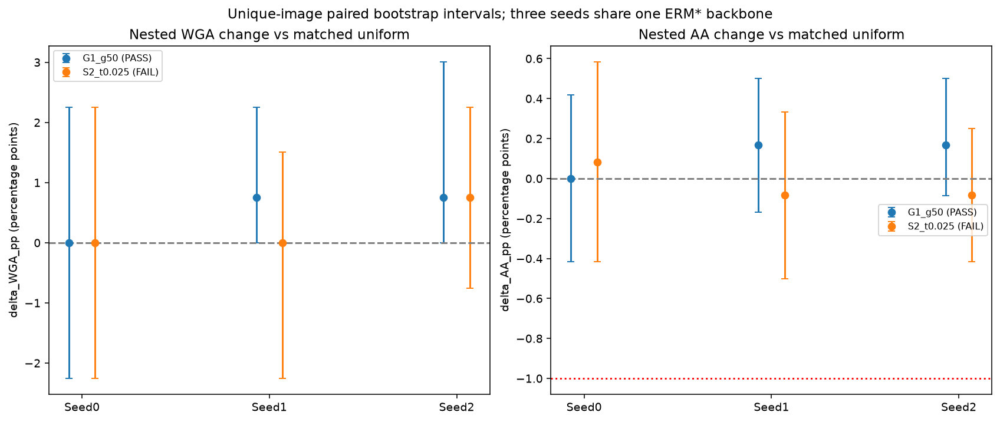

# DPE v3 — Geometry aggregation: hướng khởi sắc nhất hiện tại trong chuỗi weighting v3–v5

> **Đây là hướng cải tiến tổng hợp DPE có vẻ khởi sắc nhất trong chuỗi nghiên cứu weighting/aggregation v3–v5 đã thực hiện ở workspace này.** G1 là ứng viên vượt gate nested đã khóa: **WGA tăng trung bình 0,5013 điểm phần trăm**, **AA tăng 0,1112 điểm phần trăm**, WGA tăng ở **2/3 seed**, không seed nào vi phạm ngưỡng AA.
>
> **Kết quả tạm thời, có triển vọng nhưng chưa phải kết luận khoa học chắc chắn.** Khoảng tin cậy WGA vẫn chứa 0. Đây là nested evaluation trên development đã từng khảo sát, dùng một backbone **ERM\***; không phải kết quả test mới hay ERM chuẩn. Audit lỗi nhãn đang có trên branch này là một nghiên cứu riêng và vẫn phải được đối chiếu trước khi nâng mức kết luận.

**Ngày báo cáo:** 15/11/2026. **Branch:** `dpe_optmized_version_3-(temporal-best)`.
Tên phiên bản GitHub là v3; nghiên cứu geometry tương ứng handoff nghiên cứu **v5**.

## 1. Kết quả chính

So sánh với **Uniform DPE dùng chính xác cùng 15 head và cùng ảnh C**. Từng seed được tính bằng cách gộp toàn bộ ảnh C của ba outer fold, không lấy trung bình WGA của các fold.

| Phương pháp | WGA trung bình (%) | AA trung bình (%) | ΔWGA so với Uniform (điểm %) | ΔAA (điểm %) | Seed tăng WGA | Gate |
|---|---:|---:|---:|---:|---:|---|
| Uniform DPE đối chứng | 92,4812 | 95,7465 | — | — | — | Đối chứng |
| **G1: minimum-distance + residual** | **92,9825** | **95,8577** | **+0,5013** | **+0,1112** | **2/3** | **PASS** |
| S2: class-wise LogSumExp trên logits thật | 92,7318 | 95,7187 | +0,2506 | −0,0278 | 1/3 | FAIL |

Nguồn: [bảng đầy đủ theo seed](results/dpe/geometry_aggregation_v5_20261115/nested_per_seed_percent.csv), [quyết định promotion và khoảng tin cậy](results/dpe/geometry_aggregation_v5_20261115/promotion_decisions.json).

### G1 chi tiết theo seed

| Seed | Uniform WGA (%) | G1 WGA (%) | ΔWGA (điểm %) | Uniform AA (%) | G1 AA (%) | ΔAA (điểm %) |
|---|---:|---:|---:|---:|---:|---:|
| 0 | 90,9774 | 90,9774 | 0,0000 | 95,8299 | 95,8299 | 0,0000 |
| 1 | 93,2331 | 93,9850 | +0,7519 | 95,9133 | 96,0801 | +0,1668 |
| 2 | 93,2331 | 93,9850 | +0,7519 | 95,4962 | 95,6631 | +0,1668 |
| **Trung bình** | **92,4812** | **92,9825** | **+0,5013** | **95,7465** | **95,8577** | **+0,1112** |

G1 sửa đúng **9** và làm sai **5** dự đoán trên các hàng seed/ảnh. Một ảnh có thể xuất hiện ở nhiều seed; không coi các hàng này là các quan sát độc lập.



## 2. Vì sao đây là hướng khởi sắc nhất trong chuỗi v3–v5?

| Nghiên cứu | ΔWGA nested trung bình (điểm %) | ΔAA nested trung bình (điểm %) | Kết luận theo gate riêng đã khóa |
|---|---:|---:|---|
| LCMSW / verify-first v3 | +0,2915 | −0,8340 | FAIL: WGA chỉ tăng ở 1/3 seed; một seed giảm AA hơn 1 điểm % |
| Piecewise reliability v4, R4 | −0,5013 | +0,1668 | FAIL: WGA không tăng ở seed nào |
| **Geometry v5, G1** | **+0,5013** | **+0,1112** | **PASS: 2/3 seed tăng WGA, AA không giảm** |

Điểm đáng chú ý là **G1 không phải đổi AA lấy WGA** trong kết quả nested hiện tại. So với những hướng trước, nó đơn giản, không thêm mạng gate, không train lại backbone và đã vượt cùng loại kiểm tra nghiêm ngặt về AA/WGA.

Các hàng trên là những nghiên cứu khác nhau về cách fit và biểu diễn xác suất; đây là tổng kết tiến trình, không phải phép kiểm định thống kê trực tiếp giữa mọi phương pháp. **Không dùng bảng này để xếp hạng với nghiên cứu sửa nhãn hoặc khẳng định G1 tốt nhất toàn bộ repository.** D5 đạt khoảng 96% trên test lịch sử là một kết quả khác về dữ liệu/protocol, không so trực tiếp với AA development ở bảng trên.

## 3. Công thức G1 đã khóa

Với mỗi ảnh và head `j`, lấy khoảng cách nhỏ nhất tới hai prototype:

```text
dmin_j = min_k distance[j,k]
r_j = softmax_over_heads(-50 * dmin_j)
w_j = 0.75 / 15 + 0.25 * r_j
P_G1 = sum_j w_j * P_j
```

- `gamma = 50`, `alpha = 0.25`; không nới grid sau khi thấy WGA.
- Khoảng cách Euclidean được tính giữa feature và prototype đã chuẩn hóa L2; feature trước đó chuẩn hóa theo từng ảnh.
- Xác suất của từng head vẫn dùng **logits thật với learned scale**. Đã kiểm tra `logit_jk = -abs(scale_j) * distance_jk`; không giả định logits bằng khoảng cách âm khi scale khác 1.
- Không truyền nhãn, correctness hay group vào hàm inference. G1 không cần fitted normalizer hoặc calibrator.

Residual 75% Uniform giữ phần lớn hành vi của ensemble; 25% còn lại dùng tín hiệu geometry. Các head có weight dương, tổng weight bằng 1.

## 4. Thiết kế thí nghiệm và kiểm chứng

1. Kiểm tra hash manifest, class order, ID, quan hệ logits/probabilities/distances và tính OOF của development bundle.
2. Audit bốn tín hiệu: negative minimum distance, negative entropy, confidence và distance margin. Tính ranking ở mức ảnh, tách riêng các ảnh Uniform dự đoán sai.
3. Screen **25 cấu hình**, gồm Uniform và Top-1 diagnostic; tổng cộng **75 đánh giá cấu hình/seed**. Chọn bằng worst-class NLL và AA floor, không dùng group WGA để chọn.
4. Khóa G1 và S2 trước khi đọc WGA của các ứng viên để lựa chọn. Top-1 diagnostic không được promotion.
5. Train **135 head mới**: 3 seed × 3 outer fold × 15 head. A fit head, B fit preprocessing nếu cần, C chỉ đánh giá. A/B/C không trùng ID; B/C dùng đúng cùng ordered head.
6. Kiểm tra độc lập head hash, fit ID, epoch checkpoint, reconstruction và metric gộp. **13 tests pass**; forced-kill/resume pass; chạy lại toàn bộ resume không tính lại thí nghiệm đã hoàn tất.

Đã lưu **424 tác vụ** cùng kết quả, cache, checkpoint và hướng dẫn handoff trong workspace. Đã triển khai atomic writes, retry khi file tạm bị khóa và checkpoint model/optimizer/RNG sau từng epoch.

## 5. Kết luận cơ chế và giới hạn

**Khoảng cách không phải tín hiệu correctness đáng tin cậy một cách tổng quát.** Trên các ảnh Uniform sai trong `meta_train`, ranking correct-over-wrong của minimum distance chỉ khoảng **32,81% / 31,19% / 36,98%**, so với confidence **28,36% / 27,83% / 34,09%**. Nó nhỉnh hơn confidence nhưng vẫn dưới 50%; không thể kết luận đã tìm được oracle expert bằng geometry.

Kết quả khả quan của G1 đến từ một lượng nhỏ thay đổi gần ranh giới với residual bảo thủ, chứ không chứng minh distance routing luôn đúng. S2 có mean WGA dương nhưng chỉ một seed cải thiện nên không được tích hợp.

- **WGA 95% CI:** **[−0,2147; +1,2531] điểm %**, vẫn chứa 0.
- **AA 95% CI:** [−0,0556; +0,3058] điểm %.
- Cả ba head seed dùng chung **một backbone ERM\***; không phải ba backbone độc lập.
- Development và định danh các split đã từng được khảo sát. Nested isolation loại bỏ leakage trong lần chạy, nhưng không biến chúng thành tập xác nhận chưa từng xem.
- Các khoảng tin cậy resample cùng image ID qua các seed, có phân tầng group; không bao gồm toàn bộ bất định do train backbone hoặc chọn phương pháp.
- **Audit nhãn trên branch đích:** [nghiên cứu lỗi nhãn Waterbirds](results/dpe/label_correction_20261115/README.md) ghi nhận ba species bị gán nhãn sai và ảnh hưởng tới kết quả DPE/DFR. **G1 hiện được đánh giá theo nhãn benchmark dùng trong bundle; chưa có kết quả G1 trên protocol sửa nhãn.** Giữ nguyên các số đã đo và chưa nâng thành tuyên bố cải thiện trên nhãn đã sửa.

**Bước tiếp theo duy nhất:** xác nhận công thức đã khóa trên một development cohort mới với quy ước nhãn được kiểm tra trước, giữ group chỉ để đánh giá; không tiếp tục tune bằng các kết quả C/test đã xem.

## 6. Cách dùng và đọc kết quả

Uniform vẫn là mặc định. Bật riêng G1:

```python
probs = model.predict_proba(target="val", aggregation="distance")
metrics = model.evaluate(target="val", aggregation="distance")
```

- [Báo cáo nghiên cứu đầy đủ](results/dpe/geometry_aggregation_v5_20261115/FINAL_REPORT.md).
- [Tất cả kết quả screening](results/dpe/geometry_aggregation_v5_20261115/phase1_screen.csv) và [cấu hình đã khóa](results/dpe/geometry_aggregation_v5_20261115/phase1_locked_candidates.json).
- [Kết quả nested theo fold/seed](results/dpe/geometry_aggregation_v5_20261115/phase2_nested_results.csv), [flip theo subgroup](results/dpe/geometry_aggregation_v5_20261115/nested_corrected_broken_by_group.csv), [integrity audit](results/dpe/geometry_aggregation_v5_20261115/integrity_audit.json).
- [Metadata inference đã version](baselines/dpe4subpop/src/dpe/verified_distance_v1.json) và [hướng dẫn API/CLI](baselines/dpe4subpop/docs/geometry_aggregation_v5.md).
- [Workflow và resume](experiments/geometry_aggregation_v5/README.md).

```bash
python -m experiments.geometry_aggregation_v5.run --phase all --resume
python -m experiments.geometry_aggregation_v5.run --status
```

Checkpoint/prediction cache và gói `DPE_Geometry_v5_results.zip` được giữ trong `outputs/geometry_aggregation_v5/` của workspace. Git chỉ lưu source, bảng/biểu đồ kết quả và metadata; dataset, checkpoint lớn và prediction arrays không được đưa vào lịch sử Git.
