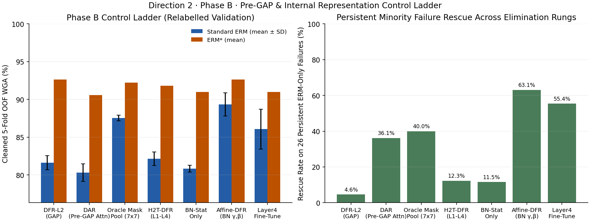
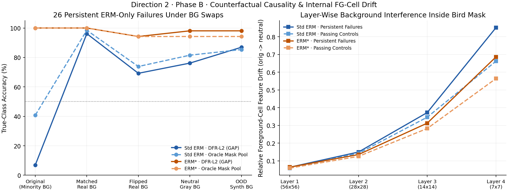
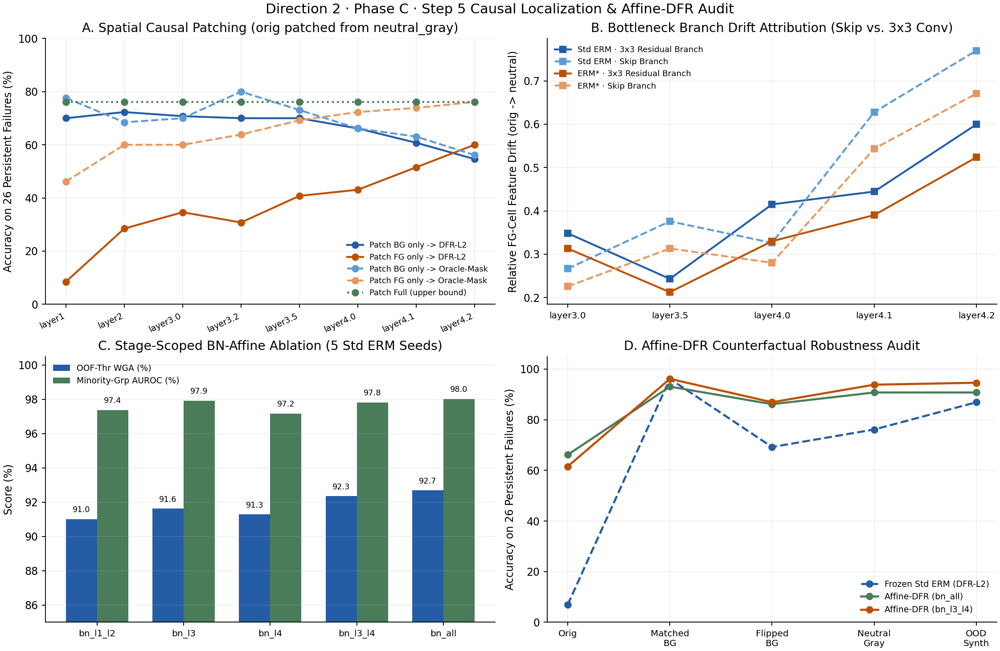
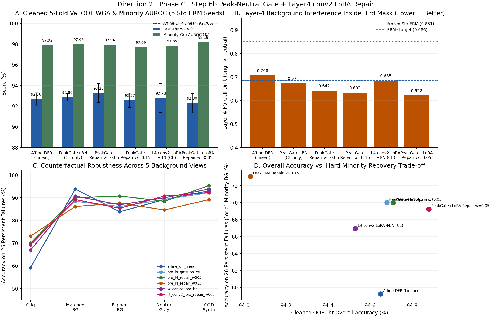
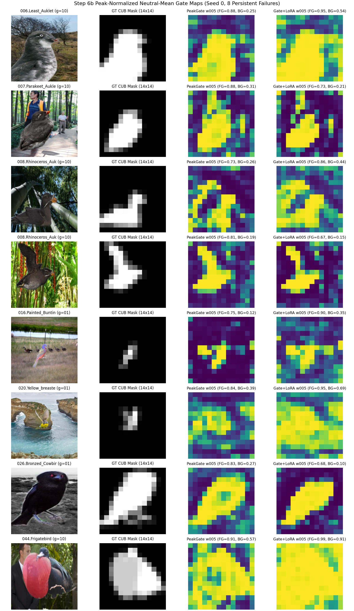
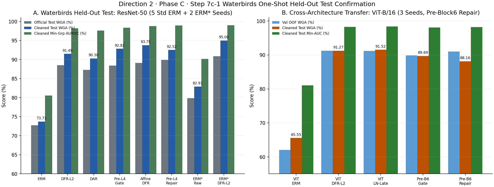
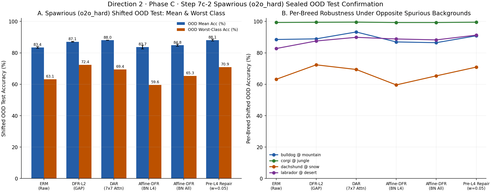
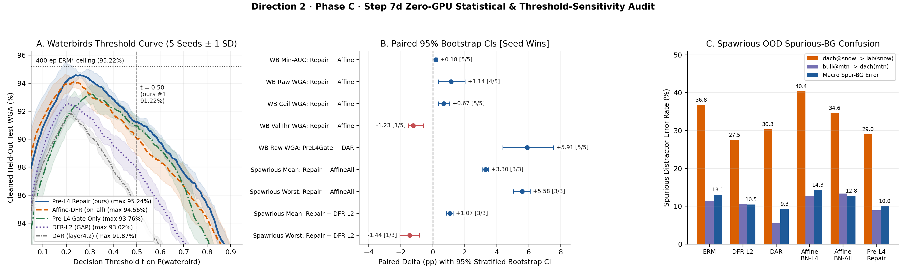

# Mechanism-Based Representation Repair Study (`rep_repair`, Phases A–C)

This report documents the complete mechanism-first investigation (**Failure Audit -> Counterfactual Causality -> Block Patching -> Minimal Pre-Mixing Repair -> Cross-Architecture & Sealed OOD Confirmation -> Zero-GPU Statistical Audit**) conducted strictly under the project's [zero-test-leakage protocol](research_protocol.md).

- **Implementation & reproduction guide:** [`src/methods/rep_repair/README.md`](../src/methods/rep_repair/README.md)
- **Complete step-by-step CSV & figure index:** [`results/rep_repair/README.md`](../results/rep_repair/README.md)
- **Notebook execution order:** [`notebooks/README.md`](../notebooks/README.md)

---

## 1. Unified Cross-Benchmark Headline Results (Held-Out Test · Step 7c + Step 7d)

Every checkpoint, neutral feature buffer, and validation threshold (`val_thresh`) was frozen on validation before unsealing Waterbirds `split == 2` (`5,794` rows) and Spawrious `o2o_hard` shifted OOD (`25,344` rows) once.

| Method | Waterbirds Off WGA (`val_thr`) | Waterbirds Raw Cln WGA (`p=0.5`) | Waterbirds Cln WGA (`val_thr`) | Waterbirds Diag Ceil `max_t` *(post-hoc)* | Waterbirds Min-Grp AUC | Spawrious OOD Mean (25.3k) | Spawrious OOD Worst-Cls | Spawrious Spur-BG Err |
|---|---:|---:|---:|---:|---:|---:|---:|---:|
| `erm_raw` | 72.74 ± 0.79 | 71.09 ± 1.50 | 73.73 ± 1.58 | 75.82 ± 0.75 | 80.57 | 83.43 ± 0.53 | 63.15 ± 1.96 | 13.07 |
| `dfr_l2` (GAP) | 88.50 ± 0.59 | 87.95 ± 0.82 | 91.49 ± 0.30 | 93.02 ± 0.24 | 98.18 | 87.07 ± 0.16 | **72.36 ± 0.54** | 10.48 |
| `dar` (`layer4.2`) | 87.26 ± 0.74 | 85.04 ± 0.48 | 90.30 ± 0.69 | 91.87 ± 0.20 | 97.62 | 88.03 ± 0.11 | 69.41 ± 0.83 | **9.31** |
| `pre_l4_gate_only` (`layer3.5`, frozen BB) | 88.38 ± 0.45 | 90.95 ± 0.74 | 92.82 ± 0.84 | 93.76 ± 0.38 | 98.36 | — | — | — |
| `affine_dfr` (`bn_all`) | 89.10 ± 0.76 | 90.08 ± 1.25 | **93.75 ± 0.72** | 94.56 ± 0.27 | 98.77 | 84.84 ± 0.69 | 65.34 ± 2.07 | 12.79 |
| **`pre_l4_repair_w005` (ours, frozen convs)** | **89.91 ± 1.81** | **91.22 ± 0.44** | 92.52 ± 1.06 | **95.24 ± 0.33** | **98.95** (**5/5**) | **88.14 ± 0.62** (**3/3 vs Aff**) | 70.92 ± 1.78 | 10.04 |
| `erm_star_dfr_l2` *(400-ep aug ref)* | 90.89 ± 0.99 | 91.15 ± 0.00 | 95.00 ± 0.31 | 95.22 ± 0.25 | 99.00 | — | — | — |

---

## 2. Phase A & Phase B: Failure Audit, Control Ladder & Counterfactual Causality (Val Only)

### 2.1 Falsifying Post-GAP Readout & Pre-GAP Attention Controls (5 `standard_erm` Seeds)

Correcting the 3.5:1 class-imbalance threshold artifact (`OOF-Thr`) and evaluating threshold-free `Min-Grp AUROC` (`01` vs `10`) establishes a reproducible `~3.0–4.3 pp` WGA gap (`~1.2–2.5 pp` Min-AUC) between `standard_erm` and `erm_star` that survives all frozen post-GAP classifiers (`DFR-L2`, `Frozen MLP`, `RBF-SVM`, `Cosine kNN`, `DPE`), pre-GAP attention (`DAR` despite achieving `72.7%–80.8%` inside-bird mask alignment), pixel-exact `Oracle-Mask-Pool` at `layer4.2`, `H2T-DFR`, and full `Layer4-FT`:

| Cohort | Method | Raw WGA (%) | OOF-Thr WGA (%) | OOF-Thr Acc (%) | Min-Grp AUC (%) | All AUC (%) |
|---|---|---:|---:|---:|---:|---:|
| `standard_erm` (5 seeds) | `DFR-L2` (GAP) | 80.98 | 90.18 | 92.59 | 96.60 | 97.87 |
| `standard_erm` | `Frozen MLP` | 91.02 | 91.31 | 93.14 | 96.61 | 97.85 |
| `standard_erm` | `Frozen RBF-SVM` | 78.20 | 89.67 | 93.31 | 96.90 | 98.57 |
| `standard_erm` | `DPE` (15-head) | 91.54 | 92.06 | 93.69 | 98.01 | 98.72 |
| `standard_erm` | `DAR` (Pre-GAP Attn) | 80.33 | 90.17 | 93.34 | 96.78 | 98.37 |
| `standard_erm` | `Oracle-Mask-Pool` (`layer4.2`) | 87.54 | 91.67 | 94.33 | 96.88 | 98.09 |
| `standard_erm` | `Layer4-FT` (15M params) | 86.07 | 91.20 | 93.49 | 97.52 | 98.47 |
| `standard_erm` | `Affine-DFR` (53k BN $\gamma,\beta$) | 89.34 | **92.66** | **94.80** | **97.92** | **98.83** |
| `erm_star` (2 seeds) | `DFR-L2` / `DPE` | 92.21 / 95.00 | 94.49 / 95.00 | 96.37 / 96.21 | 98.19 / 99.16 | 99.05 / 99.53 |

### 2.2 CUB Counterfactuals & Inside-Mask Foreground Drift

On the **26 persistent `standard_erm` minority validation failures**, swapping only the background (keeping ground-truth CUB bird pixels identical) immediately recovers `DFR-L2` from `6.9%` (`orig`) to `96.2%` (`matched_bg`) and `76.2%` (`neutral_gray`), and `Oracle-Mask-Pool` from `40.8%` to `98.5%` / `81.5%`. Measuring relative L2 activation drift **strictly inside the bird mask** (`orig -> neutral_gray`) reveals dramatic late-layer interference:

| Subset | Cohort | `layer1` (56×56) | `layer2` (28×28) | `layer3` (14×14) | **`layer4` (7×7)** |
|---|---|---:|---:|---:|---:|
| `persistent_erm_only` (26) | **`standard_erm`** | 0.0643 | 0.1501 | 0.3726 | **0.8512** |
| `persistent_erm_only` (26) | `erm_star` | 0.0648 | 0.1359 | 0.3129 | **0.6862** |
| `passing_control` (80) | `standard_erm` | 0.0590 | 0.1428 | 0.3465 | 0.6622 |

---

## 3. Phase C Step 5 & Step 6b: Causal Localization & `peak_neutral` Pre-Layer4 Repair

- **Causal block patching (Step 5):** Patching `neutral_gray` activations into `orig` shows `bg_only` accuracy stays high through `layer3.5` (`70.0%` DFR / `73.1%` Oracle) before dropping sharply across `layer4.{0,1,2}` (`54.6%` / `56.1%`), with `73.8%–75.5%` of foreground drift attributable to $3\times 3$ residual conv branches. Observational channel-bleed pruning fails (Spearman `0.116–0.150`). Full details: [`phase_c_step5_20261123/README.md`](../results/rep_repair/phase_c_step5_20261123/README.md).
- **Minimal Pre-`layer4` Repair (Step 6b):** Rescaling the mask-free gate as $\mathbf{g}' = \mathbf{g}/\max_{h,w}(\mathbf{g})$ (`peak_neutral`) before blending toward fold-train group-balanced `neutral_c3` resolves the magnitude collapse observed in unweighted gating (Step 6) and sets the validation benchmark (`pre_l4_repair_w005`): **`93.28 ± 0.90%`** OOF-Thr WGA (**4/5 seeds** vs. `affine_dfr_linear` `92.70%`), **`70.0%` `orig` CF** (`+10.8 pp`), **`90.8%` `flipped_bg`** (`+7.0 pp`), **`95.4%` `ood_bg`** (`+2.3 pp`), **`0.642` Layer-4 FG drift (`< ERM* 0.686`)**, and mask-free gate **`FG = 0.84 / BG = 0.34`**.

---

## 4. Cross-Architecture (`ViT-B/16`), Sealed OOD (`Spawrious`), & Step 7d Statistical Audit

- **ViT-B/16 mechanism vs. repair boundary (Steps 7a & 7c-1):** `ViT-B/16` exhibits the same late spatial crossover (`block_6..block_8`, `bg_only` `65.2% -> 46.7%` as `fg_only` rises `41.5% -> 58.5%`) and `2.5×` `[CLS]` drift (`1.255` vs. `0.508`). On held-out test, **`vit_ln_dfr_late` (`15.4k` params)** achieves `91.52 ± 0.60%` Cln WGA (`98.39%` Min-AUC), whereas patch-only gating at `block_6` reaches `95.59%` Overall Acc (`89.82%` Raw Cln WGA) but drops `val_thr` WGA (`88.16%`) because global attention already leaks background tokens into `[CLS]` across `blocks 0..5`.
- **Spawrious `o2o_hard` OOD shift (Steps 7b & 7c-2):** Across `25,344` images from completely unseen opposite backgrounds, **`77.7%–87.8%` of all OOD errors** are specifically predicting the training breed correlated with the test background. `Affine-DFR` overfits validation `beach` backgrounds and collapses (`84.84%` Mean / `65.34%` Worst-Class; `40.35%` `dach@snow -> labrador` for `bn_l4`). **`pre_l4_repair_w005` leads overall OOD Mean (`88.14 ± 0.62%`, `3/3` seeds vs. `Affine-DFR`)**, rescues `+5.58 pp` Worst-Class over `affine_dfr_bn_all`, and achieves the lowest non-spurious error (`1.82%`).
- **Step 7d Bootstrap & Threshold-Sensitivity Audit:** On Waterbirds ResNet-50, `pre_l4_repair_w005` wins `5/5` seeds on Min-Grp AUROC (`+0.18 pp`, 95% CI `[+0.06, +0.29]`), `4/5` on Raw `p=0.5` WGA (`+1.14 pp`, `[+0.33, +2.00]`), and `5/5` on post-hoc representation ceiling (`95.24%` vs. `94.56%`, `[+0.34, +1.06]`, matching 400-ep `ERM*` `95.22%`), while pre-registered scalar `val_thresh` calibration hit boundary extremes on 2 seeds (`0.05`, `0.44`), explaining `92.52%` vs. `93.75%`.

