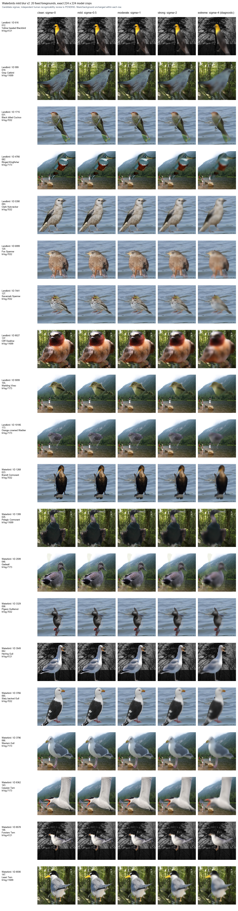
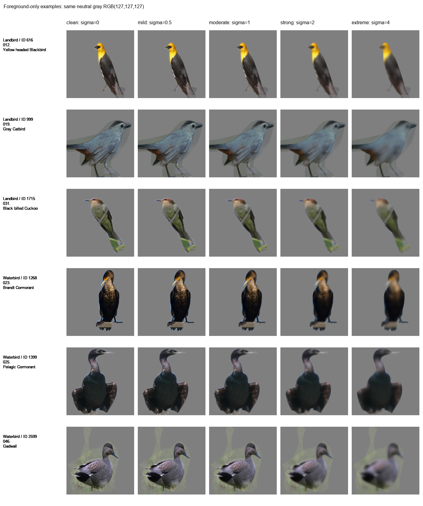

# Waterbirds mild blur v2: POTER, ERM enhanced và DPE legacy

## 1. Execution summary

**Đã hoàn thành đánh giá thật bằng checkpoint có sẵn, không train lại hoặc sửa model.** Thay bộ sigma cũ0/1,5/4/9 bằng **0/0,5/1/2** cho phân tích chính; **4** chỉ là diagnostic bổ sung. Giữ nguyên100 foreground,20 loài (50 ảnh và10 loài/lớp,5 ảnh/loài), bốn nền, pairing, mask, source test và seed20261118.

2.000 natural composites +500 foreground-only +400 background assignments +100 ảnh source gốc = **3.000 inputs/model và9.000 dòng dự đoán cho ba model**. Có 2604 ảnh raw duy nhất; background-only chỉ có4 nền lặp theo foreground. **4,500 dòng inference mới** ở sigma0,5/1/2; **4,500 dòng tái sử dụng** có checkpoint, raw pixel, crop và normalized tensor hash khớp. Sáu ảnh smoke test được chạy trực tiếp/lặp để kiểm tra parity, tách khỏi9.000 dòng chính. Vòng đánh giá có cache mất 33.17 giây, chưa gồm QC, load model, smoke và lập báo cáo.

| Model | Model seed | Checkpoint | SHA256 (rút gọn) |
|---|---|---|---|
| POTER | 1 | best_validation.pt, epoch258/300 | 4f405e0e9ec34420 |
| ERM enhanced | 0 | ckpt_last.pt, enhanced/class-balanced ERM | bce28dc72c3737ae |
| DPE legacy | 0 | 15 heads; cùng backbone ERM enhanced | 3324222c85537d5d |

Mọi SHA256 đầy đủ và giới hạn lịch sử nằm trong `checkpoint_audit.json`. ERM không phải uniform ERM tiêu chuẩn; seed/recipe chưa khớp POTER. DPE legacy thiếu hash liên kết backbone từ lúc huấn luyện; đây là cặp lưu cùng thư mục được khóa hiện tại, chưa xác minh độc lập association lịch sử. Head-training IDs khớp1.199 validation IDs canonical, không có test.

Nguồn pipeline: `src/counterfactual/compositor.py` (foreground_layer, composite), `src/counterfactual/investigation.py` (FrozenComparison, intervention_records, evaluate_stream), `src/counterfactual/model.py` và `src/datasets/waterbirds.py` (Runner/preprocess). CSV trước dùng canonical `results/poter_failure/predictions.csv`,34 cột, do `scripts/investigate_poter_failure.py` tạo. `predictions(2).csv` không được đính kèm; không giả định một bản đổi tên ngoài repository đã được kiểm tra. File mới giữ nguyên cả34 cột và thứ tự.

## 2. Image quality

Foreground được premultiply alpha rồi resize bilinear về256×256. Gaussian sau resize, trước ghép nền và center crop224×224. Vì crop không đổi scale, **sigma là pixel trong đúng input224 của model**. Preprocess resize256, crop224, RGB/ImageNet normalization và nội suy giữ nguyên. Normalized convolution blur RGB×alpha / blur alpha giữ alpha cố định, tránh trộn RGB đen của vùng trong suốt. Nền không blur. Không dùng ảnh generative AI.

Contact sheet chọn deterministically1 foreground/loài từ cohort:10 Landbird,10 Waterbird,20 loài. Mỗi foreground có một background cố định qua năm cột224×224. Contact sheet foreground-only gồm ba ảnh mỗi lớp trên xámRGB127. Đã kiểm tra dimensions, alpha, invariance và pairing trên toàn3.000 inputs **trước khi load model/inference**. Clean vàsigma4 khớp hash thí nghiệm trước.

Quan sát contact sheet vẫn thấy một số biên mask, occluder hoặc mảnh màu/nền nằm trong cutout (ví dụ vùng trên ảnh2599 và vùng quanh chân/đuôi ảnh1715). Các yếu tố này có sẵn ở clean và được giữ nguyên; không loại ảnh sau khi xem model. Nền có thể chứa người/động vật/vật thể khác. **Chưa có independent human recognizability validation**; kiểm tra tự động hay quan sát của trợ lý không xác lập ngưỡng bảo toàn nhãn semantic. Các sigma chỉ là mức ứng viên.





## 3. Main results

Mỗi natural severity/model có400 composites,200/lớp và100/nhóm lớp×nền. AA là tỷ lệ đúng trên toàn bộ400 ảnh. WGA là min của bốn group accuracy. Clean là clean recomposition trên cùng bốn nền; không đồng nhất với ảnh source gốc.

### WGA

| Model | Clean σ0 | Mild σ0,5 | Moderate σ1 | Strong σ2 | Extreme σ4 (bổ sung) |
|---|---|---|---|---|---|
| POTER | 86.00% | 83.00% | 74.00% | 58.00% | 23.00% |
| ERM enhanced | 87.00% | 86.00% | 69.00% | 39.00% | 21.00% |
| DPE legacy | 90.00% | 91.00% | 80.00% | 64.00% | 41.00% |

### Average accuracy

| Model | Clean σ0 | Mild σ0,5 | Moderate σ1 | Strong σ2 | Extreme σ4 (bổ sung) |
|---|---|---|---|---|---|
| POTER | 93.25% | 92.00% | 88.75% | 82.50% | 69.50% |
| ERM enhanced | 94.75% | 93.00% | 85.25% | 74.00% | 66.75% |
| DPE legacy | 96.25% | 96.25% | 90.25% | 85.00% | 73.75% |

### Accuracy từng lớp

| Model | Lớp | σ0 | σ0,5 | σ1 | σ2 | σ4 (bổ sung) |
|---|---|---|---|---|---|---|
| POTER | Landbird | 88.00% | 86.00% | 78.50% | 65.00% | 39.00% |
| POTER | Waterbird | 98.50% | 98.00% | 99.00% | 100.00% | 100.00% |
| ERM enhanced | Landbird | 93.50% | 93.00% | 84.00% | 68.00% | 57.00% |
| ERM enhanced | Waterbird | 96.00% | 93.00% | 86.50% | 80.00% | 76.50% |
| DPE legacy | Landbird | 93.00% | 93.00% | 81.50% | 71.00% | 49.50% |
| DPE legacy | Waterbird | 99.50% | 99.50% | 99.00% | 99.00% | 98.00% |

Ảnh source gốc100 và background-only được giữ nguyên. Neutral có nhãn chim và semantic accuracy, nhưng không có WGA bốn nhóm; background-only không có target chim, accuracy hoặc WGA. Chi tiết trong metrics.csv/group_metrics.csv/class_metrics.csv.


## 4. Class-asymmetric robustness analysis

Drop = clean−corrupted. Asymmetry = Drop Landbird−Drop Waterbird. Raw class gap = Waterbird accuracy−Landbird accuracy, bao gồm chênh lệch có sẵn ở clean. Các số dưới là điểm phần trăm (pp).

| Model | Sigma | Drop WGA | Drop Land | Drop Water | Asymmetry [CI95%] | Raw class gap |
|---|---|---|---|---|---|---|
| POTER | 0.5 | +3.00 | +2.00 | +0.50 | +1.50 [-0.50; +3.50] | +12.00 |
| POTER | 1.0 | +12.00 | +9.50 | -0.50 | +10.00 [+2.00; +18.00] | +20.50 |
| POTER | 2.0 | +28.00 | +23.00 | -1.50 | +24.50 [+14.00; +35.00] | +35.00 |
| ERM enhanced | 0.5 | +1.00 | +0.50 | +3.00 | -2.50 [-5.00; +0.00] | +0.00 |
| ERM enhanced | 1.0 | +18.00 | +9.50 | +9.50 | +0.00 [-6.50; +6.00] | +2.50 |
| ERM enhanced | 2.0 | +48.00 | +25.50 | +16.00 | +9.50 [+2.49; +17.00] | +12.00 |
| DPE legacy | 0.5 | -1.00 | +0.00 | +0.00 | +0.00 [-2.00; +2.00] | +6.50 |
| DPE legacy | 1.0 | +10.00 | +11.50 | +0.50 | +11.00 [+4.50; +19.00] | +17.50 |
| DPE legacy | 2.0 | +26.00 | +22.00 | +0.50 | +21.50 [+13.00; +31.00] | +28.00 |

Sigma4 không tham gia kết luận chính; các giá trị/CIs bổ sung nằm trong các CSV với severity=extreme. Bootstrap2.000 lần, class-stratified source foreground, cùng resampling indices cho các model/severity. Bốn background của cùng foreground đi cùng nhau; WGA được tính lại trong từng resample. CI phản ánh sampling variability theo foreground, **không** phản ánh checkpoint/training-seed uncertainty hay một tập backgrounds mới. Tương quan giữa các ảnh cùng species còn là hạn chế.

### Chênh lệch POTER−baseline trong phân tích chính

| So sánh | Sigma | Chênh Drop WGA [CI95%] | Chênh Asymmetry [CI95%] |
|---|---|---|---|
| POTER−ERM enhanced | 0.5 | +2.00 [-5.00; +5.00] | +4.00 [+1.00; +7.50] |
| POTER−ERM enhanced | 1.0 | -6.00 [-17.00; +5.00] | +10.00 [+0.00; +20.50] |
| POTER−ERM enhanced | 2.0 | -20.00 [-32.00; -8.00] | +15.00 [+3.50; +25.50] |
| POTER−DPE legacy | 0.5 | +4.00 [+1.00; +8.00] | +1.50 [-1.50; +4.50] |
| POTER−DPE legacy | 1.0 | +2.00 [-10.00; +13.00] | -1.00 [-12.50; +9.50] |
| POTER−DPE legacy | 2.0 | +2.00 [-12.00; +15.00] | +3.00 [-9.51; +14.50] |

Số dương: POTER giảm mạnh hơn baseline theo chỉ số đó. CI chứa0: chưa phân biệt rõ ở sample hiện tại. Không hiệu chỉnh nhiều so sánh; đây là exploratory comparisons của các checkpoint/recipe hiện có.

### Prediction bias ở mức mild σ0,5

| Model | Lớp thật | P(Water) clean | P(Water) σ0,5 | Pred Water clean | Pred Water σ0,5 |
|---|---|---|---|---|---|
| POTER | Landbird | 25.09% | 26.34% | 12.00% | 14.00% |
| POTER | Waterbird | 83.61% | 82.41% | 98.50% | 98.00% |
| ERM enhanced | Landbird | 7.36% | 9.37% | 6.50% | 7.00% |
| ERM enhanced | Waterbird | 94.31% | 92.39% | 96.00% | 93.00% |
| DPE legacy | Landbird | 47.52% | 47.68% | 7.00% | 7.00% |
| DPE legacy | Waterbird | 53.98% | 53.79% | 99.50% | 99.50% |

DPE score là log(mean head probability), không phải native CNN logit. Xác suất giữa các model chưa calibration chung. Không diễn giải xác suất tuyệt đối như bằng chứng model này tin cậy hơn model khác. Phân tích hướng flip và bias đầy đủ theo sigma/lớp nằm trong prediction_bias.csv, flip_metrics.csv và paired_flips.csv.


## 5. Background dependence analysis

Giữ cùng foreground/severity và ghép Land/Water theo hai pair đã khóa. Swap flip là tỷ lệ đổi nhãn dự đoán; mean absolute ΔP là trung bình |P(Water|Water background)−P(Water|Land background)|. Hai cột cuối dùng% hoặc pp như ghi trong header.

| Model | Sigma | Acc nền Land | Acc nền Water | Swap flip (%) | Mean \|ΔP\| (pp) |
|---|---|---|---|---|---|
| POTER | 0.0 | 92.00% | 94.50% | 4.50% | 5.17 |
| POTER | 0.5 | 90.00% | 94.00% | 7.00% | 5.76 |
| POTER | 1.0 | 86.50% | 91.00% | 7.50% | 7.49 |
| POTER | 2.0 | 79.00% | 86.00% | 9.00% | 9.36 |
| ERM enhanced | 0.0 | 96.00% | 93.50% | 10.50% | 12.74 |
| ERM enhanced | 0.5 | 93.50% | 92.50% | 13.00% | 16.09 |
| ERM enhanced | 1.0 | 87.00% | 83.50% | 26.50% | 28.86 |
| ERM enhanced | 2.0 | 78.50% | 69.50% | 49.00% | 48.17 |
| DPE legacy | 0.0 | 97.50% | 95.00% | 4.50% | 0.70 |
| DPE legacy | 0.5 | 97.00% | 95.50% | 4.50% | 0.73 |
| DPE legacy | 1.0 | 90.50% | 90.00% | 9.50% | 0.84 |
| DPE legacy | 2.0 | 88.50% | 81.50% | 15.00% | 1.03 |

Có thay đổi dự đoán khi đổi ảnh nền là bằng chứng nhạy cảm với context trong các cặp đã chọn. Bốn nền chứa nhiều yếu tố ngoài Land/Water; không suy ra một cơ chế causal chỉ từ việc flip. Background-only chỉ đo prediction tendency trên4 ảnh OOD, không có accuracy hay số lượng background độc lập400. CI của background-swap flip và mean absolute ΔP ở bootstrap_ci.csv; class-conditioned kết quả ở background_sensitivity.csv.

### Đối chiếu với foreground-only trên nền xám

| Model | Sigma | AA composite | AA foreground-only | Land composite | Land foreground-only |
|---|---|---|---|---|---|
| POTER | 0.5 | 92.00% | 95.00% | 86.00% | 94.00% |
| POTER | 2.0 | 82.50% | 92.00% | 65.00% | 86.00% |
| ERM enhanced | 0.5 | 93.00% | 96.00% | 93.00% | 94.00% |
| ERM enhanced | 2.0 | 74.00% | 80.00% | 68.00% | 62.00% |
| DPE legacy | 0.5 | 96.25% | 96.00% | 93.00% | 92.00% |
| DPE legacy | 2.0 | 85.00% | 80.00% | 71.00% | 62.00% |

Đây là so sánh point estimates trên cùng100 foreground, nhưng natural có4 nền/foreground còn neutral có1. POTER ởsigma2 có Landbird accuracy cao hơn khi đặt trên xám so với bốn nền đã chọn; hướng chênh không đồng nhất giữa các model. Điều này cho thấy việc xem isolation control là cần thiết, chưa chứng minh nguyên nhân hay khái quát sang background mới. CIs riêng của neutral trong bootstrap_ci.csv, không dùng chúng như một CI paired cho chênh neutral−composite.


## 6. Comparison with previous experiment

So sánh theo **sigma thực**, không theo tên mild/moderate/strong: mild cũ=1,5 còn mild mới=0,5; moderate cũ=4 là extreme mới. Không dùng chúng làm cùng điều kiện. Shared settingssigma0 và4 có raw input/model crop/normalized tensor hashes giống nhau trên mọi foreground/nền/model. Các row này tái sử dụng đúng xác suất/log-score cũ sau xác minh hash; đây không phải rerun độc lập toàn bộ shared rows. Ngoài cache,12 model-image rows sharedsigma trong smoke được inference trực tiếp để kiểm tra numerical parity.

| Model | Sigma chung | Tên cũ | Tên mới | WGA cũ | WGA mới |
|---|---|---|---|---|---|
| POTER | 0 | clean | clean | 86.00% | 86.00% |
| POTER | 4 | moderate | extreme | 23.00% | 23.00% |
| ERM enhanced | 0 | clean | clean | 87.00% | 87.00% |
| ERM enhanced | 4 | moderate | extreme | 21.00% | 21.00% |
| DPE legacy | 0 | clean | clean | 90.00% | 90.00% |
| DPE legacy | 4 | moderate | extreme | 41.00% | 41.00% |

shared_sigma_reproducibility.csv giữ đối chiếu đầy đủ; shared_sigma_inference_smoke.csv ghi sai số rerun thực. Các điểm cũsigma1,5 và9 được giữ nguyên ở thư mục cũ và không trộn vào đường cong chính mới. Hiệu ứng lớn ởsigma9 trước đây không thể dùng làm bằng chứng rằng blur0,5 cũng gây collapse. Phân tích mới kiểm tra trực tiếp vùngsigma thấp, tách giảm accuracy nhỏ ở0,5 khỏi đáp ứng lệch lớp rõ hơn ở1–2.

## 7. Research implications

**Ở mild σ0,5:** CI asymmetry trong từng model đều chạm/chứa0 ở mẫu này; chưa đủ bằng chứng để gọi suy giảm lệch về Landbird rõ ràng ở cả ba. POTER có raw class gap ở clean; phần chênh sẵn này không được tính như degradation-induced asymmetry.

**POTER so với baseline:** bảng paired cho thấy ở0,5 chênh Drop WGA POTER−DPE là +4.00 [+1.00; +8.00] pp, nhưng chênh asymmetry POTER−DPE là +1.50 [-1.50; +4.50] pp. Có bằng chứng chênh WGA-drop trong bộ checkpoint này ở0,5, chưa đủ bằng chứng khác biệt về asymmetry với DPE. Ở2, POTER có WGA-drop ít hơn enhanced ERM (xem CI âm trong bảng), dù đáp ứng lệch lớp lớn hơn ERM. Không kết luận POTER yếu hơn mọi baseline theo mọi tiêu chí.

**Bias khi blur nhẹ:** bảng conditional prediction cho thấy các thay đổi nhỏ ở0,5 và bias có sẵn ởclean. Đó là mô tả xác suất/nhãn dự đoán; không chứng minh class preference là cơ chế causal. Ở1–2, CIs asymmetry của POTER và DPE nằm trên0; hiệu ứng không chỉ xuất hiện ởPOTER.

### Sigma 0.5

- **POTER:** asymmetry +1.50 [-0.50; +3.50] pp; CI chứa0, chưa phân biệt rõ mức suy giảm giữa hai lớp.
- **ERM enhanced:** asymmetry -2.50 [-5.00; +0.00] pp; CI chứa0, chưa phân biệt rõ mức suy giảm giữa hai lớp.
- **DPE legacy:** asymmetry +0.00 [-2.00; +2.00] pp; CI chứa0, chưa phân biệt rõ mức suy giảm giữa hai lớp.

### Sigma 1

- **POTER:** asymmetry +10.00 [+2.00; +18.00] pp; CI nằm trên0, hỗ trợ suy giảm lệch về Landbird trong mẫu này.
- **ERM enhanced:** asymmetry +0.00 [-6.50; +6.00] pp; CI chứa0, chưa phân biệt rõ mức suy giảm giữa hai lớp.
- **DPE legacy:** asymmetry +11.00 [+4.50; +19.00] pp; CI nằm trên0, hỗ trợ suy giảm lệch về Landbird trong mẫu này.

### Sigma 2

- **POTER:** asymmetry +24.50 [+14.00; +35.00] pp; CI nằm trên0, hỗ trợ suy giảm lệch về Landbird trong mẫu này.
- **ERM enhanced:** asymmetry +9.50 [+2.49; +17.00] pp; CI nằm trên0, hỗ trợ suy giảm lệch về Landbird trong mẫu này.
- **DPE legacy:** asymmetry +21.50 [+13.00; +31.00] pp; CI nằm trên0, hỗ trợ suy giảm lệch về Landbird trong mẫu này.

Mức độ POTER dễ bị tổn thương hơn baseline phải đọc từ **chênh lệch drop paired và CI**, không suy ra chỉ từ accuracy tuyệt đối ở một severity. Các bảng trên tách WGA-drop và asymmetry; một model có thể lệch lớp hơn nhưng không mất WGA nhiều hơn. Prediction bias và sự thay đổi theo background là mô tả đầu ra có điều kiện; chưa xác nhận class prior hay background reliance là cơ chế gây ra suy giảm. Không điều chỉnh sigma/cohort/checkpoint sau khi xem kết quả.

## 8. Limitations and next steps

- Một checkpoint/method, seed và training recipe không khớp hoàn toàn. Không có CI training-seed.
- Cohort100 là existing official test đã được nghiên cứu, không phải held-out cohort mới độc lập.
- Chưa có independent human recognizability validation; sigma0,5/1/2 không phải ngưỡng semantic đã xác nhận.
- Mask, occlusion, center crop, vị trí ghép và background objects có thể gây artifacts.
- Chỉ20 loài,5 foreground/loài và4 nền được reuse; không khái quát CI sang nền/species mới.
- DPE legacy thiếu hash liên kết backbone lịch sử; current pair và checkpoint hashes được khóa, nhưng association cũ chưa được chứng minh.
- CI exploratory chưa hiệu chỉnh multiple comparisons. Không dùng test cohort để train hoặc tune hyperparameters.

Bước tiếp theo: nhận đánh giá độc lập của con người trên contact sheet trước khi gọi can thiệp bảo toàn semantic; kiểm tra mask có occluder/mảnh nền; dùng cohort/background mới đã khóa và checkpoint đa seed khớp recipe nếu có. Giữ nguyên mọi kết quả hiện tại.

### Tái lập và kiểm tra

```powershell
.\.venv\Scripts\python.exe scripts\run_mild_blur_v2.py --stage qc
.\.venv\Scripts\python.exe scripts\run_mild_blur_v2.py --stage infer
.\.venv\Scripts\python.exe scripts\run_mild_blur_v2.py --stage report
```

Chạy mới bằng output_root mới trong configs/mild_blur_v2.yaml. Không ghi đè predictions cũ. Bản output này có status completed; integrity.json khóa file, sourcecode hashes trong blur_config.json/analysis_provenance.json. Các kiểm tra counts/duplicates/missing/label/tensor/group coverage nằm trong validation.json.

### Các file kết quả

- `predictions.csv`: 9.000 dòng, nguyên34 cột của schema trước.
- `metrics.csv`, `group_metrics.csv`, `class_metrics.csv`, `degradation_metrics.csv`, `prediction_bias.csv`.
- `paired_flips.csv`, `flip_metrics.csv`, `background_sensitivity.csv`, `bootstrap_ci.csv`.
- `blur_contact_sheet.png`, `foreground_only_contact_sheet.png`, `blur_config.json`, `qc_foregrounds.csv`.
- `accuracy_vs_blur.png`, `wga_vs_blur.png`, `class_accuracy_vs_blur.png`, `group_accuracy_vs_blur.png`.
- `waterbird_probability_vs_blur.png`, `prediction_flip_rates.png`, `foreground_only_vs_composite.png`.
- `image_integrity.csv`, `qc_audit.json`, `shared_sigma_reproducibility.csv`, `shared_sigma_inference_smoke.csv`.
- `prediction_reuse_audit.csv`, `cohort.csv`, `checkpoint_audit.json`, `smoke_test.json`, `timings.json`.
- `validation.json`, `analysis_provenance.json`, `status.json`, `tests.log`, `integrity.json`, `report.md`.
- `examples/`: ảnh/mask và30 ảnh đầu vào cho mỗi một trong hai foreground định trước.

`files_manifest.csv` liệt kê chính xác mọi file sản phẩm, kích thước và SHA256 (trừ chính manifest và integrity.json để tránh vòng hash).

Kết quả kiểm tra tự động: 32 passed in 27.93s

Failure Case Explorer cho đúng bộ mild v2: [mở gallery](http://127.0.0.1:8789). Đã kiểm tra bằng trình duyệt: bộ lọc sigma0,5, ba dự đoán/case, đúng100 source gốc, background-only không gán accuracy và ảnh hiển thị khớp hash, không có page errors.

Nếu cần mở lại:
```powershell
.\.venv\Scripts\python.exe scripts\failure_case_explorer.py --comparison-root outputs/mild_blur_v2 --port 8789
```
