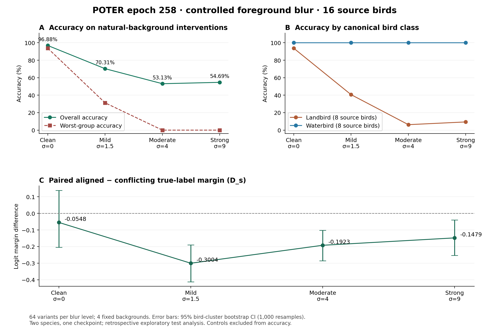
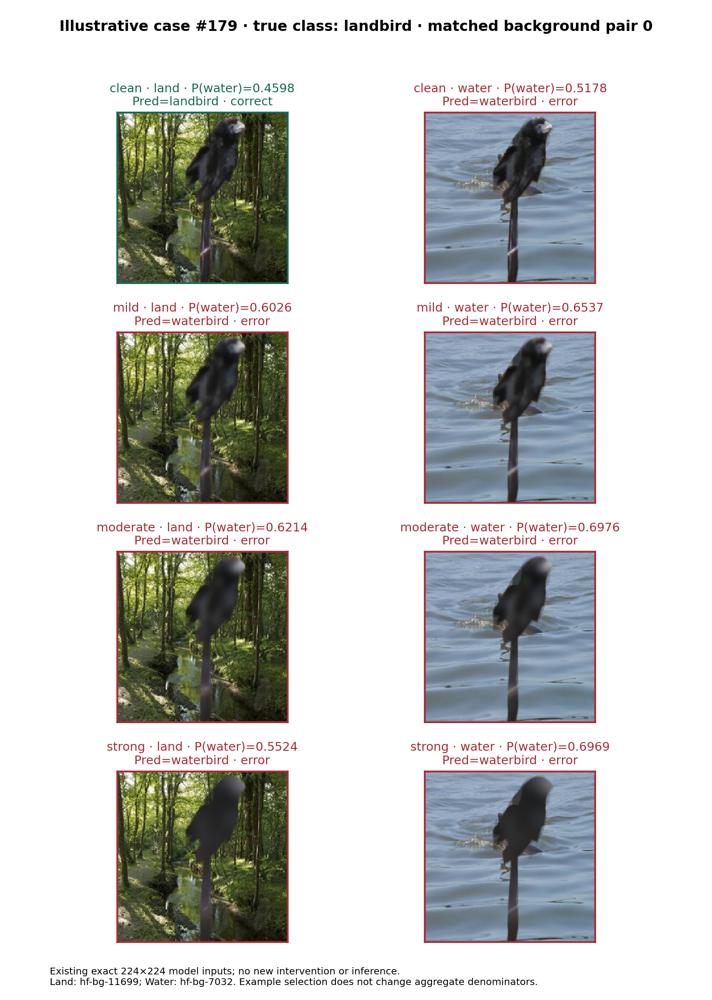

# Báo cáo các run Counterfactual Lab và Failure Case Explorer

**Ngày báo cáo:** 18/11/2026 · **Phạm vi:** tổng hợp các run đã lưu; không chạy thêm suy luận hoặc huấn luyện để lập báo cáo này.

## 1. Kết quả chính

Pipeline đã chạy với checkpoint POTER thật và hoàn tất cả quy trình tạo ảnh có kiểm soát, suy luận, lưu run, mở lại trong Explorer và xuất kết quả.

Run chính gồm **16 chim nguồn, 400 dòng dự đoán và 340 ảnh đầu vào duy nhất theo hash**. Trong đó có 256 biến thể chim trên nền tự nhiên, 64 dòng nền không có chim, 64 dòng chim trên nền trung tính và 16 ảnh gốc. Nền không có chim chỉ có bốn ảnh duy nhất, lặp lại theo 16 chim nguồn; không được coi là 64 mẫu độc lập.

Trên 256 biến thể nền tự nhiên, mô hình có **80 lỗi phân loại**. Có **10 lần đổi nhãn dự đoán giữa hai nền trong 128 so sánh cặp**, xuất hiện ở **6 chim nguồn**; đây không phải 10 chim độc lập. Ảnh gốc có một lỗi riêng, ở chim #192. Hai loại lỗi này không gộp chung mẫu số accuracy.

Khi làm mờ foreground, accuracy giảm từ **96,88% ở clean** xuống **53,13% ở moderate** và **54,69% ở strong**. Sự giảm không đơn điệu ở mọi mức. Các lỗi trên ảnh can thiệp đều là **Landbird bị dự đoán thành Waterbird** trong cohort này.

**Diễn giải nghiên cứu:** kết quả cho thấy độ nhạy với suy giảm chi tiết chim và một số can thiệp nền. Chỉ số margin đã định nghĩa chưa cho thấy tăng ưu tiên nền đồng nhãn: D_s và Amplification trung bình không tăng dương khi blur mạnh hơn. Không kết luận từ các run này rằng POTER nói chung phụ thuộc nền nhiều hơn khi mất tín hiệu foreground.

## 2. Thiết lập và dữ liệu

- Mô hình: POTER / ResNet-50, checkpoint epoch **258**, chọn theo validation trước thí nghiệm; không chọn hoặc điều chỉnh mô hình bằng nhãn test.
- SHA-256 checkpoint: `4f405e0e9ec34420aeae5fc2452635c6bc700d714fd033c4c289bea9d2434a9e`.
- Nhãn chuẩn: `y=0` Landbird, `y=1` Waterbird; `place=0` Land, `place=1` Water.
- Tiền xử lý: resize vuông 256×256 → center crop 224×224 → tensor RGB → ImageNet normalization. Lưu đúng ảnh RGB 224×224 trước normalization.
- Dữ liệu đã kiểm tra: 17.382 ảnh Hugging Face; 5.794 bộ scene/foreground/background ghép được với metadata. Ngân hàng có 2.897 nền Land và 2.897 nền Water.
- Foreground: 5.794 cutout từ **RGB và mask CUB gốc đã xác minh**, không dùng ảnh sinh bằng AI. Tất cả ảnh HF cung cấp thuộc official test, dù tên loader HF là `train`.
- Hai tập nền trùng pixel chính xác được ghi nhận và loại khỏi lấy mẫu tự động; 63 tập va chạm average-hash là ứng viên cần kiểm tra, không phải xác nhận trùng ngữ nghĩa.

Cohort chính được ấn định bằng **tám ID test đầu tiên theo số cho mỗi lớp**, trước khi chạy inference; seed lấy nền là 2026. Có hai nền Land và hai nền Water, tái sử dụng cho mọi chim và mức blur. Cohort thực tế chỉ gồm **8 Groove-billed Ani (Landbird)** và **8 Black-footed Albatross (Waterbird)**. Vì vậy lớp và loài bị gắn với nhau trong mẫu nhỏ này.

Các mức Gaussian là clean σ=0, mild σ=1,5, moderate σ=4 và strong σ=9, tính theo pixel ở model view. Alpha, vị trí, kích thước và opacity giữ cố định giữa hai nền tại cùng mức. Blur chỉ tác động lên foreground bằng normalized convolution; các kiểm tra xác nhận RGBA layer giống nhau, foreground opaque bất biến và vùng ngoài mask bằng nền đã chọn.

## 3. Kết quả run chính

### 3.1. Accuracy và WGA trên nền tự nhiên

| Mức blur | σ | Đúng / tổng | Accuracy | WGA | Lỗi | Flip / cặp |
|---|---|---|---|---|---|---|
| clean | 0.0 | 62/64 | 96.88% | 93.75% | 2 | 2/32 |
| mild | 1.5 | 45/64 | 70.31% | 31.25% | 19 | 3/32 |
| moderate | 4.0 | 34/64 | 53.13% | 0.00% | 30 | 2/32 |
| strong | 9.0 | 35/64 | 54.69% | 0.00% | 29 | 3/32 |

Mỗi mức có 64 biến thể được tạo từ **16 ID ảnh chim nguồn**. Mỗi ảnh nguồn xuất hiện trên bốn nền. WGA được tính trên bốn nhóm `(nhãn chim, loại nền)`, mỗi nhóm có 16 biến thể; WGA bằng 0 ở moderate/strong vì nhóm Landbird/Land có 0/16 đúng, không phải vì thiếu nhóm.

Ảnh gốc được đánh giá riêng: **15/16 đúng = 93.75%**, WGA **66.67%**. Mẫu số từng nhóm ảnh gốc là 3, 5, 5 và 3, khác với biến thể can thiệp. Không coi chênh lệch giữa accuracy ảnh gốc và clean recomposite là cải thiện hiệu năng trên cùng một benchmark.

### 3.2. Phân rã theo lớp và nhóm

| Mức | Landbird — 32 biến thể | Waterbird — 32 biến thể |
|---|---|---|
| clean | 93.75% | 100.00% |
| mild | 40.63% | 100.00% |
| moderate | 6.25% | 100.00% |
| strong | 9.38% | 100.00% |

| Nhóm — 16 biến thể / mức | Clean | Mild | Moderate | Strong |
|---|---|---|---|---|
| Landbird / Land | 15/16 (93.75%) | 5/16 (31.25%) | 0/16 (0.00%) | 0/16 (0.00%) |
| Landbird / Water | 15/16 (93.75%) | 8/16 (50.00%) | 2/16 (12.50%) | 3/16 (18.75%) |
| Waterbird / Land | 16/16 (100.00%) | 16/16 (100.00%) | 16/16 (100.00%) | 16/16 (100.00%) |
| Waterbird / Water | 16/16 (100.00%) | 16/16 (100.00%) | 16/16 (100.00%) | 16/16 (100.00%) |

Tổng 80 lỗi can thiệp phân bố trên cả tám Landbird. Tám Waterbird đều được dự đoán đúng trong các biến thể đã chạy. Điều này phù hợp với xu hướng dự đoán Waterbird khi chi tiết của các Landbird trong cohort bị làm yếu; dữ liệu hiện tại chưa tách được ảnh hưởng của lớp, loài và đặc điểm hình ảnh.



### 3.3. Paired margin và mức khuếch đại

Định nghĩa `m_y = logit(y thật) − logit(lớp còn lại)`; `D_s = mean[m_y(nền đồng nhãn) − m_y(nền trái nhãn)]`; `Amplification(s) = D_s − D_clean`.

| Mức | D_s | CI 95% của D_s | Amplification | CI 95% của Amplification |
|---|---|---|---|---|
| clean | -0.0548 | [-0.2042; 0.1380] | 0.0000 | [0.0000; 0.0000] |
| mild | -0.3004 | [-0.4122; -0.1896] | -0.2456 | [-0.4278; -0.0916] |
| moderate | -0.1923 | [-0.2861; -0.1017] | -0.1375 | [-0.3459; 0.0431] |
| strong | -0.1479 | [-0.2536; -0.0397] | -0.0931 | [-0.3273; 0.1187] |

CI được bootstrap **1.000 lần theo chim nguồn**, sau khi lấy trung bình các cặp của từng chim. Các CI này điều kiện trên bốn nền cố định và một checkpoint; không phản ánh bất định do chọn ngân hàng nền mới hoặc seed huấn luyện mới.

D_s âm có nghĩa margin trung bình nghiêng về nền trái nhãn trong những cặp đã chọn. Amplification tại mild âm; CI của Amplification tại moderate và strong chứa 0. Các kết quả này không hỗ trợ phát biểu “blur làm tăng ưu tiên nền đồng nhãn” trên cohort hiện tại. Paired flips là dấu hiệu nhạy với can thiệp nền, không tự xác lập nguyên nhân shortcut.

## 4. Các run một chim và controls

| Operator | Run ID | Tổng dòng | Biến thể tự nhiên | Đúng | Paired flips |
|---|---|---|---|---|---|
| gaussian | 20261118T123339Z_06e2f340ac | 15 | 8 | 8 | 0 |
| contrast | 20261118T125909Z_f754cb571a | 15 | 8 | 8 | 0 |
| occlusion | 20261118T125922Z_7cc3576177 | 15 | 8 | 8 | 0 |

Cả ba run đại diện dùng cùng Waterbird #1, với tám biến thể nền tự nhiên mỗi run. Tất cả tám biến thể đều đúng và không có paired flip. Đây là smoke test trên một cá thể đã xuất hiện trong cohort chính; không cộng như dữ liệu độc lập. WGA không xác định vì thiếu hai nhóm Landbird; CI theo chim nguồn cũng không xác định với một chim.

Contrast dùng hệ số 1 / 0,75 / 0,4 / 0,1 quanh trung bình màu foreground có trọng số alpha. Occlusion che 0 / 10 / 30 / 50% pixel trong alpha support bằng RGB 127, với tâm và thứ tự che cố định theo seed. Hai operator này nằm trong run và chart riêng, không trộn với Gaussian. Ảnh clean của cả ba operator đã được đối chiếu và giống nhau theo byte ở cùng geometry và nền.

### Controls nền không có chim của run chính

| Background ID | Loại nền | Số dòng lặp | P(waterbird) trung bình |
|---|---|---|---|
| hf-bg-11699 | land | 16 | 0.5847 |
| hf-bg-7032 | water | 16 | 0.6643 |
| hf-bg-4121 | land | 16 | 0.6210 |
| hf-bg-7173 | water | 16 | 0.5091 |

Đây là bốn ảnh nền duy nhất, mỗi ảnh được chạy lặp 16 lần theo cấu trúc factorial. Cả bốn có P(waterbird)>0,5, kể cả nền Land. Bộ phân loại đóng vẫn phải trả phân phối trên hai lớp chim dù không có chim. Các con số này là **chẩn đoán OOD**, không có nhãn chim thật để tính accuracy hoặc WGA. Chim trên nền xám cũng được lưu như control riêng và bị loại khỏi các mẫu số accuracy.

## 5. Minh họa một failure case

Chim **#179**, nhãn thật Landbird, cặp nền 0: Land `hf-bg-11699`, Water `hf-bg-7032`. Ở clean, P(waterbird) thay đổi từ **0,4598** sang **0,5178**, làm đổi nhãn dự đoán. Ở mild, cả hai nền đều bị dự đoán thành Waterbird. Các mức khác được hiển thị đầy đủ dưới đây.



Đây là minh họa hậu nghiệm từ kết quả đã lưu; không được dùng thay thống kê của toàn bộ 256 biến thể. Flip clean này ở gần ngưỡng 0,5, nên không nên diễn giải như một thay đổi xác suất lớn. Hình dùng các PNG 224×224 đã có, không tạo can thiệp mới hoặc chạy lại mô hình.

## 6. Kiểm tra tính đúng và phần mềm

- Đối chiếu với POTER Runner đang chạy: **pixel model view giống hoàn toàn**; sai lệch xác suất tối đa trên cùng CPU là **1.490e-08**. CPU so với CUDA lệch tối đa **4.156e-05**, được ghi riêng như sai khác số học giữa thiết bị.
- Đối chiếu độc lập với loader/transform Runner trước refactor: cùng GPU batch cho sai lệch logits bằng 0. Repeated inference cùng batch cho sai lệch xác suất bằng 0; batch size 1/2 nằm trong tolerance đã lưu.
- Bộ test áp dụng cho Windows: **241 passed, 9 skipped, 5 deselected, 27 subtests passed**. Bộ acceptance của app: **15 passed**, gồm inference thật và ba operator. Tám kiểm tra Mixer và kiểm tra serialization của controls UI đều pass.
- Năm test bị loại là các test orchestration/notebook cũ phụ thuộc Linux hoặc cách ghi đường dẫn Unix. Danh sách và lệnh nằm trong [báo cáo kỹ thuật](../../docs/counterfactual_validation.md).
- Đã mở hai app, tạo run, đọc lại sau khi lưu, lọc failure, xem exact crop và xuất PNG/PDF/CSV/JSON. Một case packet #190 có 25 row ID và xác suất khớp giữa CSV, JSON và metadata PNG.
- Setup offline giữ nguyên các hash mẫu; snapshot vật lý có danh mục SHA-256 để tránh tải lại dữ liệu không đổi. Baseline POTER không bị sửa và không có huấn luyện mới.

## 7. Danh mục toàn bộ run đã lưu

| Run ID — UTC | Operator | Chim nguồn | Dòng dự đoán | Vai trò |
|---|---|---|---|---|
| 20261118T120628Z_ebf2840e00 | gaussian | 1 | 14 | repeated_QA |
| 20261118T123059Z_48f0272960 | gaussian | 16 | 400 | main_cohort |
| 20261118T123339Z_06e2f340ac | gaussian | 1 | 15 | representative_smoke |
| 20261118T123846Z_1f31a11c5f | gaussian | 1 | 15 | repeated_QA |
| 20261118T125909Z_f754cb571a | contrast | 1 | 15 | representative_smoke |
| 20261118T125922Z_7cc3576177 | occlusion | 1 | 15 | representative_smoke |
| 20261118T130858Z_17c1fdb45d | contrast | 1 | 15 | repeated_QA |

Tổng có **7 run hoàn tất và 489 dòng dự đoán được lưu**. Những run `repeated_QA` phục vụ kiểm tra browser/API hoặc lặp lại pipeline; không gộp chúng vào ước lượng hiệu năng độc lập. Thống kê ở mục 3 chỉ dùng run chính 400 dòng. Run ID dùng thời gian UTC; giờ Việt Nam bằng UTC+7.

## 8. Giới hạn và phạm vi kết luận

1. Đây là `retrospective_exploratory`: dữ liệu test đã được dùng để quan sát, không phải xác nhận độc lập trên test mới.
2. Chỉ 16 chim, hai loài, bốn nền cố định và một checkpoint. Các biến thể lặp theo chim; không phải 256 chim độc lập hoặc đánh giá toàn bộ 5.794 chim.
3. Nền chưa được lọc tự động về người/động vật; một số ảnh nền có người. Các tín hiệu bối cảnh cùng thay đổi khi đổi ảnh nền, không chỉ nhãn Land/Water trừu tượng.
4. Không có so sánh DPE thực nghiệm vì thiếu cặp heads/backbone tương thích có hash ràng buộc. Adapter đã có nhưng không tạo dự đoán thay thế.
5. Kết quả hỗ trợ việc xác nhận pipeline, tìm failure và đặt giả thuyết về tín hiệu foreground. Chưa đủ để khẳng định hiệu năng toàn Waterbirds, ưu thế của POTER/DPE, hoặc quan hệ nhân quả tổng quát về shortcut amplification.

## 9. Tệp bằng chứng và tái tạo báo cáo

- [Predictions run chính](../../experiments/counterfactual_lab/20261118T123059Z_48f0272960/predictions.csv), [manifest](../../experiments/counterfactual_lab/20261118T123059Z_48f0272960/manifest.csv), [paired metrics](../../experiments/counterfactual_lab/20261118T123059Z_48f0272960/paired_metrics.csv), [summary](../../experiments/counterfactual_lab/20261118T123059Z_48f0272960/summary.json), [cấu hình](../../experiments/counterfactual_lab/20261118T123059Z_48f0272960/run_config.json).
- [CSV chỉ số Gaussian](gaussian_metrics.csv), [CSV chỉ số nhóm](group_metrics.csv), [CSV controls nền](background_only_diagnostics.csv), [danh mục run](run_inventory.csv).
- [Nguồn dữ liệu và kiểm tra tải](../../DATASET_PROVENANCE.md), [chi tiết triển khai/kiểm thử](../../docs/counterfactual_validation.md).

Tạo lại đúng báo cáo từ các run đã lưu, không chạy mô hình:

```powershell
.\.venv\Scripts\python.exe scripts/report_counterfactual_runs.py
```

Các run gốc được giữ nguyên. Báo cáo và hình ở đây là sản phẩm tổng hợp từ CSV/JSON/PNG hiện có.
