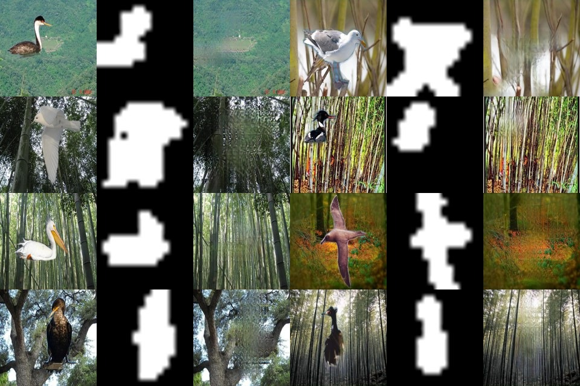
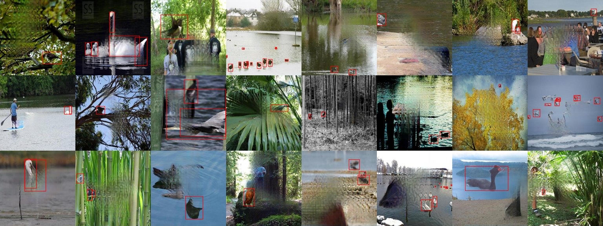
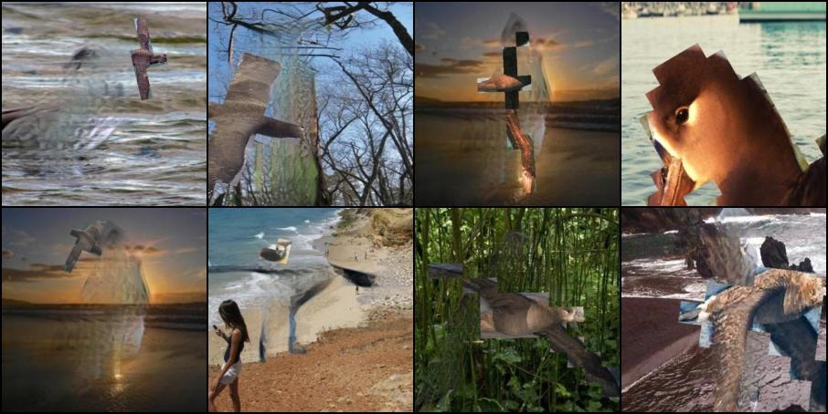
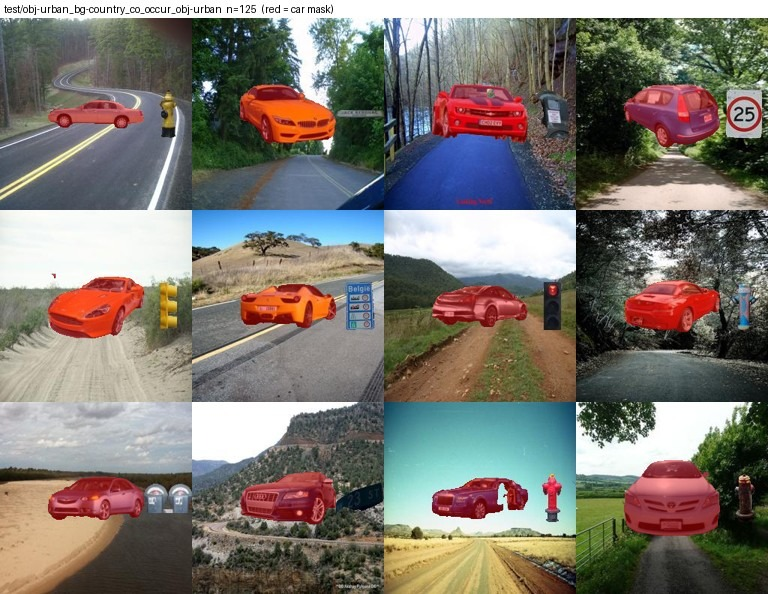
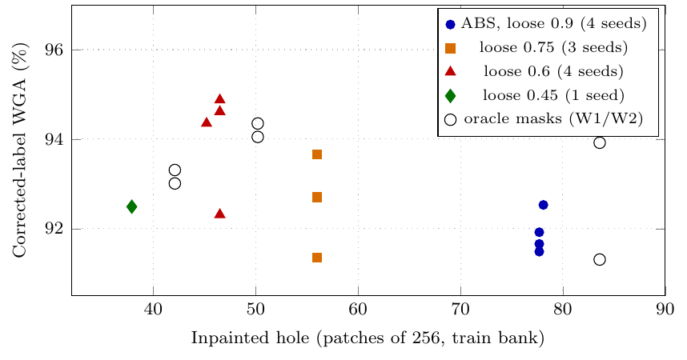

# Background Shortcut Learning Mitigation for Waterbirds: Week 5 Progress Report (Extending AutoBackSwap)

Nguyen Dinh Minh Huy. LaTeX source: `main.tex` (same content, Springer LNCS template as Weeks 1, 2 and 4); PDF: `main.pdf`.

**Abstract.** We reproduced AutoBackSwap (ABS) on Waterbirds in earlier weeks and matched the paper's worst-group accuracy (WGA). This week we used the reproduction to ask what ABS actually changes in an image and where it may still leak the shortcut. We report five observations, five hypotheses and the experiments run so far. The strongest result is on a second dataset: on UrbanCars, where a background and a co-occurring object are both shortcuts, a matched ERM model loses 74 points on the hardest group while binary ABS loses 1 point, so the planned three-way ABS has no failure to fix. On Waterbirds, shrinking the inpainted hole looks helpful on corrected labels (+2.2 points at 3 seeds, +1.8 at a new detector seed) but is not statistically significant and does not appear on the official labels. We say what would settle it.

## 1. Where the previous report stopped

The personal report of 17 November closed the AutoBackSwap reproduction (ten runs, WGA within 2σ of the paper in all four settings) and left four items open.

| Open item | Status now |
|---|---|
| ABS accuracy 94.0–94.7 vs paper 95.1 | Still unexplained. A seed-0 retrain on Kaggle is bit-identical to the earlier run, so it is not noise. |
| Three mislabelled species (90 test images) | Measured. Re-scoring 21 prediction files with the 90 images corrected changes ERM WGA by up to +3.3 and ABS by −0.8 to +1.7 points. We now report official, corrected and clean views together. |
| Perturb test backgrounds | Not done; replaced by oracle-mask and hole-size controls (Section 5). |
| More seeds, with-minority | Not done for ABS with-minority (seed 0 only). |
| Second dataset | New: UrbanCars generated with the official script and trained (Section 5.1). |

## 2. What we observed

**O1. The labels hide the sign of the effect.** Three species with "tern" in the name (90 test, 72 train, 18 validation images) are landbirds labelled as waterbirds. ABS without minority trains on 68 of them. When a model correctly says "landbird" for one of these test images, the official metric counts it wrong, so the worst group of a better model can move to a different group (verified per group for W3).

**O2. The hole is much larger than the bird.** ABS removes the foreground by inpainting a "loose" mask. The figure shows original, loose mask (white = inpainted) and inpainted result for ABS as shipped. Averaged over 4,555 bank images the hole covers 77.7 of 256 patches, while the bird mask from the CUB segmentation (coverage above 0.25) covers 42.1.



**O3. Birds remain in the background bank.** Even with generous holes, 27–29% of bank images keep at least one true-bird patch outside the hole, and a COCO bird detector flags 3.25% of the inpainted images at score 0.5. Red boxes below: small birds elsewhere in the scene, reflections, or parts of the original bird.



**O4. The composed training image is not natural.** Recomposed images (smoke test, oracle masks) show a bird cut-out pasted on another image's background with visible seams, cropped parts and remains of the original bird. A classifier could learn the seam or leftover border instead of the species.



**O5. A matched ERM collapses on two shortcuts; ABS does not.** UrbanCars has a car on a context background and a co-occurring object (fire hydrant, parking meter). With the paper's recipe, ERM drops by 74 points on the group where both shortcuts disagree with the label. ABS drops by 1 point.



## 3. Hypotheses

- **H1** (from O2): a smaller inpainted hole improves ABS, because less real background is destroyed and the composed image is closer to natural.
- **H2** (from O3, O2): a hole that is too small leaves enough of the bird in the bank to leak the label, so the gain reverses below some size. The curve has an optimum.
- **H3** (from O4 and the shape of H2): the classifier can use seams or leftover border pixels as a cue. This is a possible mechanism for H2 and is untested.
- **H4** (from O5): binary ABS already handles two simultaneous shortcuts when the second shortcut lies in the background region; the co-object lies in the pasted foreground in 0 of 8,000 training images.
- **H5** (from O1): part of every reported gain in this setting is label noise, so claims must hold on official, corrected and clean views together.

## 4. Method: the knob we changed

```
train image -> foreground detector (EfficientNet-B0, 200 images)
            -> [loose threshold: 0.9 default; 0.75, 0.6, 0.45 here]  => hole size
            -> AOT-GAN inpaints the hole -> background bank
            -> paste bird (tight mask 0.33) on a bank background -> ResNet-50
```

We vary only the loose threshold. A lower threshold gives a smaller hole, so more original background and more bird remnants in the bank. H1 and H2 say these two effects compete.

## 5. Experiments and results so far

All runs: ResNet-50, ABS without minority, official code at `b060532`, Kaggle T4. Scores are WGA (%) on three label views. Seeds in brackets.

| Exp. | Arm | Hole | Official | Corrected | Clean |
|---|---|---:|---:|---:|---:|
| W1 (2) | ABS detector (3) | 77.7 | 92.33 | 91.69 | 92.33 |
| | soft oracle mask | 50.2 | 93.30 | 94.20 | 95.01 |
| W2 (2) | oracle, hard 0.25 | 42.1 | 93.69 | 93.16 | 93.97 |
| | oracle dilated, same hole as ABS | 83.6 | 92.27 | 92.62 | 93.30 |
| W3 (3) | loose 0.75 | 56.0 | 92.40 | 92.57 | 93.24 |
| | loose 0.6 | 46.5 | 91.90 | 93.93 | 94.39 |
| W4 (1) | loose 0.9, own detector | 78.1 | 93.39 | 92.53 | 93.39 |
| | loose 0.6 | 45.2 | 92.52 | 94.35 | 94.81 |
| | loose 0.45 | 37.9 | 86.76 | 92.49 | 92.49 |



*Corrected-label WGA of every run against the inpainted hole size. Smaller holes score higher down to about 45 patches; the single point at 37.9 is lower.*

**W1/W2: the oracle gain is mostly hole size.** Replacing the detector by the CUB segmentation gives +0.97 points on official labels (inconclusive on the pre-registered rule). Giving the oracle the same hole size as ABS removes the gap on official labels (−0.06) and leaves +0.9 on corrected labels (standard error about 1.3). This supports H1 and says mask accuracy is not the bottleneck.

**W3: tighter loose mask.** With a shared seed-0 detector and bank, loose 0.6 raises corrected WGA by +2.24 points (per seed +2.69, +0.83, +3.22). The pre-registered rule is met, but the paired t gives p ≈ 0.09, the exact permutation test with 3 vs 3 runs has a minimum p of 0.10, and on official labels the change is −0.43. The seed spread of the new arms (1.2–1.4) is five to six times that of ABS (0.22). An external audit reached the same conclusion: W3 is *suggestive*, not a finding.

**W4: a new detector and a point below 0.6.** Seed 3 with its own detector, all three thresholds from that detector (one classifier per arm): 0.6 is +1.82 over 0.9 on corrected labels; 0.45 is −0.04 over 0.9 and −1.87 under 0.6. Both pre-registered rules (replication of at least +1 point; turning point at least 1 point below 0.6) hold, with n = 1. On official labels 0.45 is −6.6 points, again mostly from the mislabelled images.


*Share of the target bird left outside the hole (train bank). It grows as the hole shrinks, from about 2% to 17%; images with at least one bird patch left go from 27–29% (loose 0.9) to 87–91% (loose 0.6) and 98% (0.45).*

Together W3 and W4 are consistent with H1 and H2 (an optimum near 0.6), and the leakage above is a plausible reason for the turn. None of it is established.

### 5.1 UrbanCars: two shortcuts

We generated UrbanCars with the official script (8000 train, 1000 val, 1000 test; the paper says 500). The first ERM with the repository recipe lost only 36 points on the BG+CoObj group, much less than the paper (about 69). The gap came from the training recipe, not the number of epochs or the checkpoint choice: the paper-matched recipe (official transforms, SGD lr 1e-3, batch 128 as 2×64, 150 epochs) gives −74.06 (95% CI [−79.2, −68.8]).


*BG+CoObj gap, 95% bootstrap CIs, one seed. ERM −36.4 and −74.1; ABS +1.7 and −1.0 (repository recipe, paper-matched).*

Binary ABS has I.D. accuracy 97.83 and gap −1.03 ([−3.67, 1.62]), which is +73 points over the matched ERM. Mask statistics show the co-object lies in the pasted foreground in 0.07% of pixels and in 0 of 8,000 images, so it is swapped with the background (H4). The three-way ABS branch of the plan loses its motivation. Caveats: one seed, n = 125 per composition, and ABS I.D. accuracy moves from 97.83 to 96.39 when the checkpoint rule changes.

## 6. Proposed experiments

GPU-hours are Kaggle T4×2 estimates from W3/W4 timings.

| ID | Question and design | Decision rule | Cost |
|---|---|---|---|
| P1 | Is the loose-threshold effect real? 5 detectors, each generating loose {0.9, 0.6, 0.5, 0.45}; one classifier per arm; report all three label views | 0.6 beats 0.9 by ≥ 1 point on corrected and not worse than −1 on official, same sign in ≥ 4 of 5 detectors | about 12–15 h |
| P2 | Does the bank leak the label? Probe classifier trained on inpainted bank images only, per hole size (class from remnant bird) | probe accuracy above the place-only baseline grows as the hole shrinks | about 0.5 h |
| P3 | Do seams or borders carry the label (H3)? Probe that detects "composed vs. real"; mask dilation r = 0, 1, 2 with feathered paste | composed-image detector is easy and correlates with the class | about 1 h per variant |
| P4 | UrbanCars ERM and ABS, seeds 1–2, official worst-group checkpoint named in advance | ABS gap within ±5 at all seeds: three-way ABS stays dropped | about 5.4 h per seed |
| P5 | Binary ABS when the second shortcut touches the foreground (move the co-object into the car mask in synthetic UrbanCars) | gap worse than −15: this is where three-way ABS could matter | design first, then 2–3 h |
| P6 | ABS features with DPE heads; compare to MaskTune on corrected labels | report only; no gate | about 3 h |

P1 comes first and is the only one that can turn W3–W4 into a claim. P2 and P3 are cheap and explain *why*; they need no new detector. The Kaggle weekly GPU quota has about 2 hours left, so P1 and P4 wait for the reset; P2 and P3 fit now.

## 7. Limits

W3 and W4 are the same method family with few seeds; the new arms share detectors or have a single classifier. The primary endpoint of W3 was fixed in `docs/W_STATUS.md` (workspace repository) before launch, but the corrected view itself was chosen after the label bug was known. The paper's numbers were taken from earlier notes, not re-read from the PDF. All text results, scoring scripts and prediction files are in the workspace repository (`ndmhuy/AutoBackSwap-repro`, private); the weights are on a private disk.
