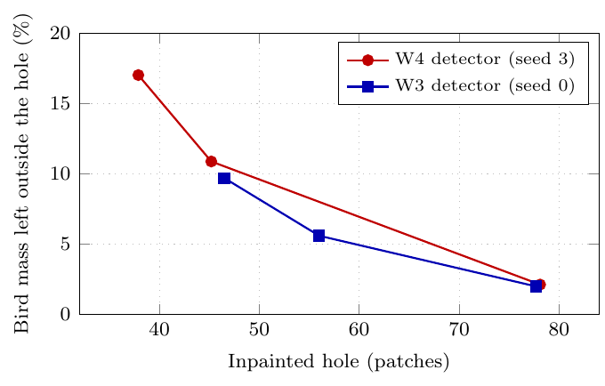
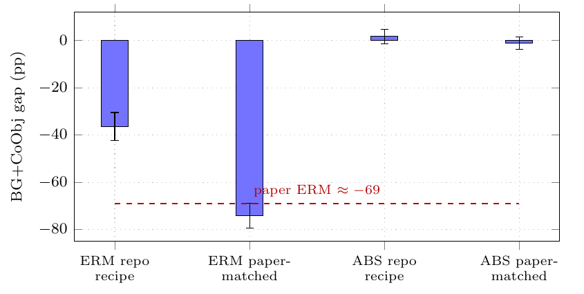

# Background Shortcut Learning Mitigation for Waterbirds: Week 5 Progress Report (Extending AutoBackSwap)

Nguyen Dinh Minh Huy. LaTeX source: `main.tex` (same content, Springer LNCS template as Weeks 1, 2 and 4); PDF: `main.pdf`.

**Abstract.** Image classifiers often rely on a shortcut: in Waterbirds, a bird photographed over water is usually a waterbird, so a model can guess from the scenery. AutoBackSwap (ABS, arXiv 2606.32018) fights this by cutting the bird out, inpainting the hole it leaves, and pasting the bird onto other backgrounds. We reproduced ABS in earlier weeks and matched the paper's worst-group accuracy. This week we asked what ABS changes in an image and where it may still leak the shortcut. We report five observations, five hypotheses and the experiments run so far. (1) On UrbanCars, where a background and a co-occurring object are both shortcuts, an ERM model trained with the paper's recipe loses 74 points on the hardest group while binary ABS loses 1 point (one seed), so the planned three-way ABS currently has no failure to fix. (2) On Waterbirds, shrinking the inpainted hole raises worst-group accuracy by about 2 points when the 90 mislabelled test images are corrected, but the effect is not statistically significant, one result has a single seed, the corrected view was chosen after we found the label bug, and the original labels show no gain. We state what would settle it.

## 1. Setting and terms

**Task and metric.** Waterbirds: classify a bird photo as *landbird* or *waterbird*. In training about 95% of waterbirds are on water backgrounds and landbirds on land, so the background is a shortcut. Test images fall into four **groups** (bird type × background): landbird on land (LL), landbird on water (LW), waterbird on land (WL), waterbird on water (WW). **WGA** (worst-group accuracy) is the accuracy on the worst of these four groups; a model that guesses from the background scores low on LW or WL. **ERM** is ordinary training with no mitigation. A **seed** is the random seed of one training run; we report means over seeds.

**ABS** (the paper we reproduce is arXiv 2606.32018; code `cesro7/spur-corr` at commit `b060532`). (i) A *foreground detector* (EfficientNet-B0 trained on 200 images) scores each of the 16×16 = 256 image patches. A patch belongs to the **tight mask** if its background score is below 0.33 (confidently bird) and to the **loose mask** if it is below 0.9 (anything not almost surely background). (ii) The loose mask is the **hole**: an inpainting network (AOT-GAN) fills it, giving a background image. The set of these inpainted images is the **bank**. (iii) A training image is the bird (tight mask) pasted on a random bank background, and a ResNet-50 is trained on these images. A *lower loose threshold gives a smaller hole*; "hole size" below is the mean number of the 256 patches in the loose mask, measured on 4,555 training images. In **"no-minority"** runs only the two common groups (LL, WW) feed the pipeline; "with-minority" runs also give the classifier the rare groups (LW, WL).

**Three label views.** 90 test images are landbirds labelled as waterbirds, because the species filter looked for the substring "tern" and also matches Eas**tern** and Wes**tern** (72 train, 18 validation images are affected as well). We therefore score every run three ways: **official** (labels as shipped), **corrected** (those 90 images relabelled landbird, groups recomputed) and **clean** (those 90 images dropped). Clean equals official, or corrected, when the worst group contains none of the 90 images.

**Oracle masks.** Replacing the detector with the human bird segmentation from CUB (the source of the bird photos) gives an *oracle* mask: a soft one (loose = coverage above 0.10), a hard one at coverage above 0.25 ("H25"), and one dilated by one patch ("DIL") to match ABS's hole size.

**Statistics used.** "Seed spread" is the standard deviation of WGA over seeds. "Paired t" compares arms seed by seed; the exact permutation test with 3 vs 3 runs cannot go below p = 0.10. Confidence intervals are 95% stratified bootstrap (2,000 draws). *Pre-registered* means the rule was written in the repository before the run was launched; the rules are stated in Section 5. Paper numbers quoted below were taken from our earlier notes and were not re-read from the PDF.

**UrbanCars.** A car photo with a context background (country or urban) and a co-occurring object (e.g. fire hydrant). Each of the 8 *compositions* (car type, background, co-object, 125 test images each) is one cell. **I.D.** accuracy is on compositions where both shortcuts agree with the label; **BG gap**, **CoObj gap** and **BG+CoObj gap** are the accuracy changes, relative to I.D., when the background, the co-object, or both disagree with the label (0 = no shortcut use, negative = the shortcut hurts). **Binary ABS** is the pipeline above (one foreground, one background bank); **three-way ABS** would add a third, separately swapped region for a second shortcut object.

## 2. Where the previous report stopped

The personal report of 17 November closed the ABS reproduction (ten runs, WGA within 2σ of the paper in all four settings, σ = the paper's reported standard deviation) and left four items open.

| Open item | Status now |
|---|---|
| ABS overall accuracy 94.0–94.7 vs paper 95.1 | Still unexplained. A seed-0 retrain on Kaggle is bit-identical to the earlier run, so the run is deterministic; seed noise across different seeds is not ruled out. |
| Three mislabelled species (90 test images) | Measured. Corrected minus official WGA over 21 prediction files: ERM +2.4 to +3.3, ABS no-min −0.8 to −0.3, ABS with-min +1.7. All three label views are now reported. |
| Perturb test backgrounds | Not done; replaced by oracle-mask and hole-size controls (Section 5). |
| More seeds, with-minority | Not done for ABS with-minority (seed 0 only). |
| Second dataset | New: UrbanCars generated with the official script and trained (Section 5.1). |

## 3. What we observed

**O1. The labels hide the sign of the effect.** When a model correctly says "landbird" for one of the 90 images, the official metric counts it wrong, so the worst group of a better model can move to another group. Example from W3 (loose 0.6, seed 0 vs ABS seed 0): terns-on-land that the model calls landbird: 35 of 43 vs 27 of 43; all of them count as errors on official labels.

**O2. The hole is much larger than the bird.** The figure shows original, loose mask (white = inpainted) and inpainted result for ABS as shipped (loose 0.9). The mean hole is 77.7 of 256 patches; the bird mask from the CUB segmentation (coverage above 0.25) covers 42.1.


**O3. Birds remain in the background bank.** Even with generous holes, 27–29% of bank images keep at least one true-bird patch outside the hole (measured against the CUB segmentation), and, separately, a COCO-trained bird detector flags 3.25% of the inpainted images at score 0.5. Red boxes below: small birds elsewhere in the scene, reflections, or parts of the original bird.


**O4 (visual impression only). The composed training image is not natural.** Recomposed images from a smoke test with oracle masks show a bird cut-out pasted on another background with visible seams, cropped parts and remains of the original bird. We have not tested whether a classifier uses these (H3).


**O5. A paper-recipe ERM collapses on two shortcuts; ABS does not.** UrbanCars is shown below (red = car mask). With the paper's training recipe, ERM scores −74.1 on the BG+CoObj gap; ABS scores −1.0. With the weaker repository recipe the gaps are −36.4 and +1.7.


## 4. Hypotheses

- **H1** (from O2): a smaller inpainted hole improves ABS, because less real background is destroyed and the composed image is closer to natural.
- **H2** (from O3, O2): a hole that is too small leaves enough of the bird in the bank to leak the label, so the gain reverses below some size. The curve has an optimum.
- **H3** (from O4, as a mechanism for H2): the classifier can use seams or leftover border pixels as a cue. Untested.
- **H4** (from O5): binary ABS handles two simultaneous shortcuts when the second shortcut lies in the background region.
- **H5** (from O1): label noise contributes to some reported gains in this setting, so claims must hold on all three label views.

## 5. Method and results so far

```
train image -> foreground detector -> [loose threshold: 0.9 default; 0.75, 0.6, 0.45 here] => hole size
            -> AOT-GAN inpaints the hole -> bank of backgrounds
            -> paste bird (tight mask, 0.33) on a bank background -> ResNet-50
```

In W3 and W4 we change only the loose threshold; in W1/W2 we also swap the mask source (oracle, dilated oracle). All runs: ResNet-50, ABS no-minority, tight 0.33, Kaggle T4. Scores are WGA (%) on the three label views; the "Hole" column is in patches (of 256).

**Pre-registered rules.** W3 (written before launch): *success* if WGA is monotone in hole size (smaller hole, higher WGA) and at least one arm is ≥ 1.0 point above the control at 3 seeds on corrected labels (a practical bar, not a significance test). W4: *replicated* if corrected WGA(0.6) ≥ WGA(0.9) + 1.0 with a smaller hole; *turning point* if WGA(0.45) ≤ WGA(0.6) − 1.0; with one classifier per arm no significance is claimed.

| Exp. (seeds) | Arm | Hole | Official | Corrected | Clean |
|---|---|---:|---:|---:|---:|
| W1/W3 (3) | **ABS loose 0.9 = control for W3** | 77.7 | 92.33 | 91.69 | 92.33 |
| W1 (2) | soft oracle mask | 50.2 | 93.30 | 94.20 | 95.01 |
| W2 (2) | oracle, hard 0.25 | 42.1 | 93.69 | 93.16 | 93.97 |
| W2 (2) | oracle dilated (hole 83.6 vs ABS 77.7) | 83.6 | 92.27 | 92.62 | 93.30 |
| W3 (3) | loose 0.75 | 56.0 | 92.40 | 92.57 | 93.24 |
| W3 (3) | loose 0.6 | 46.5 | 91.90 | 93.93 | 94.39 |
| W4 (1) | loose 0.9, own detector | 78.1 | 93.39 | 92.53 | 93.39 |
| W4 (1) | loose 0.6 | 45.2 | 92.52 | 94.35 | 94.81 |
| W4 (1) | loose 0.45 | 37.9 | 86.76 | 92.49 | 92.49 |


*Corrected-label WGA of every run against the hole size. Smaller holes score higher down to about 45 patches; the single point at 37.9 is lower.*

**W1/W2: how much of the oracle gain is hole size?** The soft oracle (hole 50.2) scores +2.5 over ABS on corrected labels and +0.97 on official labels (inconclusive on the pre-registered rule). Giving the oracle a hole about as large as ABS's (DIL, 83.6 vs 77.7) leaves +0.9 on corrected labels (standard error about 1.3) and −0.06 on official labels. So much of the oracle gain disappears when the hole is made equally large; this fits H1 but, with 2 seeds, is only suggestive. Mask accuracy alone is therefore probably not the bottleneck.

**W3: tighter loose mask (control = the three ABS runs above).** With a detector and bank shared across seeds (seed 0), loose 0.6 raises corrected WGA by +2.24 points (per seed +2.69, +0.83, +3.22); the pre-registered rule is met. But the paired t gives p ≈ 0.09, the exact permutation test has a minimum p of 0.10, and on official labels the change is −0.43. The seed spread of the new arms (1.2–1.4) is five to six times that of ABS (0.22). An external audit reached the same conclusion: W3 is *suggestive*, not a finding.

**W4: a new detector and a point below 0.6.** Seed 3 with its own detector, all three thresholds generated from it, one classifier per arm. On corrected labels 0.6 is +1.82 over 0.9; 0.45 is −0.04 over 0.9 and −1.87 under 0.6. Both pre-registered rules hold, with n = 1 (one run is about one seed spread, so each difference could be noise). On official labels 0.45 is −6.6 points, mostly from the mislabelled images.



*Share of the target bird left outside the hole (train bank). It grows as the hole shrinks, from about 2% to 17%; images with at least one bird patch left go from 27–29% (loose 0.9) to 87–91% (loose 0.6) and 98% (0.45).*

Reading W3 and W4 together: the data fit an optimum near 0.6 (H1 and H2) but are not enough to establish it. Leakage is already about three times higher at 0.6 than at 0.9, yet 0.6 still scores higher, so leakage at that level did not cancel the gain; whether it explains the drop at 0.45 is untested (P2).

### 5.1 UrbanCars: two shortcuts

We generated UrbanCars with the official script (8,000 train, 1,000 val, 1,000 test; the paper says 500, we have not resolved whether that is per split). The first ERM with the repository recipe lost only 36 points on BG+CoObj, much less than the paper's about 69. The difference came from the training recipe, not epochs or checkpoint choice: the paper-matched recipe (official transforms, SGD lr 1e-3, batch 128 as 2×64, 150 epochs) gives −74.06 (95% CI [−79.2, −68.8], which contains the paper's −69). A *checkpoint rule* picks which epoch is tested; the official rule keeps the best worst-group validation epoch.



*BG+CoObj gap, 95% bootstrap CIs, one seed. Left to right: ERM repository recipe −36.4, ERM paper-matched −74.1, ABS repository recipe +1.7, ABS paper-matched −1.0.*

Binary ABS (paper-matched) has I.D. accuracy 97.83 and gap −1.03 ([−3.67, 1.62]), about +73 points over the matched ERM. Mask statistics: the co-object lies in the pasted foreground (at least half of its area inside the tight mask) in 0 of 8,000 training images, and only 0.07% of its pixels fall inside the tight mask, so it travels with the swapped background (H4). The three-way ABS branch loses its motivation for now. Caveats: one seed, n = 125 per composition, and ABS I.D. accuracy moves from 97.83 to 96.39 when the checkpoint rule changes. P4 below would confirm it.

## 6. Proposed experiments

GPU-hours are Kaggle T4×2 estimates from W3/W4 timings. "Same sign" in P1 means 0.6 beats 0.9 in the same direction.

| ID | Question and design | Decision rule | Cost |
|---|---|---|---|
| P1 | Is the loose-threshold effect real? 5 detectors, each generating loose {0.9, 0.6, 0.5, 0.45}; one classifier per arm; report all three label views | 0.6 beats 0.9 by ≥ 1 point on corrected and is not worse than −1 on official, same sign in ≥ 4 of 5 detectors | about 12–15 h |
| P2 | Does the bank leak the label? Train a probe on inpainted bank images only (no pasted bird), per hole size, to predict the bird class; baseline = background place only | probe accuracy above the place-only baseline and rising as the hole shrinks | about 0.5 h |
| P3 | Do seams or borders carry the label (H3)? Train a probe to tell composed from real images; dilate the mask by r = 0, 1, 2 and feather the paste | composed-image detector scores well above 50% and its output correlates with the class | about 1 h per variant |
| P4 | UrbanCars ERM and ABS, seeds 1–2, checkpoint rule named in advance (official worst-group) | ABS gap within ±5 at every seed: three-way ABS stays dropped | about 5.4 h per seed |
| P5 | Binary ABS when the second shortcut touches the foreground (synthetic UrbanCars with the co-object moved onto the car mask) | gap worse than −15 (about a fifth of the ERM collapse): three-way ABS could matter | design first, then 2–3 h |
| P6 | ABS features with the DPE method (the team's prototype-ensemble head); compare to MaskTune on corrected labels | report only; no gate | about 3 h |

P1 comes first and is the only one that can turn W3–W4 into a claim. P2 and P3 are cheap and explain *why*; they need no new detector. The Kaggle weekly GPU quota has about 2 hours left, so P1 and P4 wait for the reset; P2 and P3 fit now.

## 7. Limits

W3 and W4 are the same method family with few seeds; the W3 arms share one detector and W4 has a single classifier per arm. The W3 primary endpoint was fixed in `docs/W_STATUS.md` (workspace repository) before launch, but the corrected view itself was chosen after the label bug was known, and the official labels show no gain. Paper numbers (95.1, about 69, 500) are from earlier notes, not re-read from the PDF. All text results, scoring scripts and prediction files are in the workspace repository (`ndmhuy/AutoBackSwap-repro`, private); weights are on a private disk.
