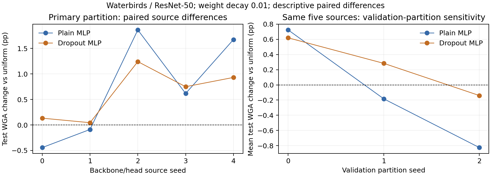

# Five-seed DPE prediction-aggregation verification

## Conclusion

The run completed all requested evaluations. Learned aggregation improves mean test worst-group accuracy (WGA) over uniform averaging on the primary Waterbirds partition. Prediction dropout improves WGA over uniform on all five source seeds, but it does not establish a benefit over plain MLP: plain MLP has the higher five-seed mean. Dropout gains over uniform reverse on one of two alternative validation partitions. The defensible result is a promising, partition-sensitive aggregation approach, not a demonstrated dropout-specific advance or a proven reduction in background reliance.

## Evidence and provenance

Analyzed on 2026-11-12 from the uploaded `verification_results.zip`. The archive SHA256 is `92ef12b1b434f39827541b9f0877cf62dafc644a559ddb5cab9f50b007453c72`. The result context is `five_seed_verification-f01228278c`. Original training evidence was saved in [Kaggle version 368677926](https://www.kaggle.com/code/noerula/dpe-mlp-dropout-verification?scriptVersionId=368677926); recovery provenance is preserved separately. This archive does not identify the final recovery notebook version, so that version is not inferred.

- Five independently seeded backbone/head sources: reused seeds 0–2 and new seeds 3–4. Reusing earlier sources does not create new independent evidence for those three seeds. The two new seeds are reported separately because the original three were already explored.
- 150 primary rows: 30 procedures × 5 sources; 200 combiner fits: 10 initializations × 2 MLP variants × 2 weight decays × 5 sources; 300 alternative-partition rows; 45 control rows.
- The completion status, row counts, source identities and independent numerical checks agree. The 200 initialization fits and alternative partitions are nested within five sources, not additional independent backbone runs.
- `repository_tests.txt` records 169 passed, 14 deselected and 14 warnings. Passing code checks does not establish scientific superiority.

## Fixed protocol

Official Waterbirds splits: train 4,795; validation 1,199; test 5,794. Test groups (00,01,10,11) contain (2,255,2,255,642,642) examples. Architecture: ImageNet-initialized ResNet-50; 100 epochs, class-balanced SGD, learning rate 0.001, momentum 0.9, backbone weight decay 0; final-epoch checkpoint without validation checkpoint selection. Images use deterministic square resize 256, center crop 224 and ImageNet normalization.

Each frozen backbone supplies raw features to 15 prototype heads. The primary group-stratified validation partition uses seed 0: 720 head-training examples and 479 combiner-training examples. Heads use 20 epochs with one balanced, drop-last optimizer update per epoch; head epochs are selected using the head-training pool. Combiners use the separate 479-example pool, group-balanced loss, 400 CPU float64 AdamW steps, learning rate 0.01, hidden width 8 and tanh. Weight decays 0.01 and 0.001 are reported independently. Prediction dropout rate is 0.25 during fitting; inference has no dropout. No candidate-selection split was introduced. All declared fits are frozen before test scoring; test features can be extracted after the backbone freezes but do not fit heads or combiners.

The source commit is `8e14249f4b3510363be06f627182e2daa9926179`. A narrow runtime adapter extends the stage-0 seed guard to seeds 3 and 4 while retaining the original recipe. Runtime: Python 3.13.16, PyTorch 2.11.0+cu130, torchvision 0.26.0+cu130, NumPy 2.1.3, SciPy 1.16.3, Pillow 13.0.0 and Tesla T4. The archived `environment.json` and `execution_contract.json`, plus the experiment record, preserve these details.

## Primary results

Values below are percentages; SD is the sample SD across source seeds in percentage points (pp). CSV accuracies are fractions. The reported statistic is the mean of each source’s minimum group accuracy, not the minimum of pooled group accuracies.

| Procedure | Mean WGA (%) | Source SD (pp) | Mean change vs uniform (pp) |
| --- | ---: | ---: | ---: |
| logistic-wd0.01 | 89.5580 | 0.5061 | +0.3243 |
| mlp-wd0.001 | 89.9667 | 0.5784 | +0.7329 |
| mlp-wd0.01 | 89.9578 | 0.6100 | +0.7241 |
| mlp_dropout-wd0.001 | 89.8625 | 0.2117 | +0.6288 |
| mlp_dropout-wd0.01 | 89.8537 | 0.2159 | +0.6199 |
| uniform | 89.2337 | 0.6059 | +0.0000 |

| Source seed | Uniform WGA (%) | Plain MLP, wd 0.01 (%) | Dropout MLP, wd 0.01 (%) | Dropout − uniform (pp) |
| ---: | ---: | ---: | ---: | ---: |
| 0 | 89.7561 | 89.3126 | 89.8891 | +0.1330 |
| 1 | 90.0222 | 89.9335 | 90.0665 | +0.0443 |
| 2 | 88.7805 | 90.6430 | 90.0222 | +1.2417 |
| 3 | 88.7850 | 89.4013 | 89.5344 | +0.7493 |
| 4 | 88.8248 | 90.4984 | 89.7561 | +0.9313 |

The new seeds alone give dropout gains over uniform of +0.8403 pp (wd 0.01) and +0.8625 pp (wd 0.001). Plain MLP gains are +1.1449 and +1.1893 pp, respectively. Thus the new sources support the primary-partition gain over uniform but do not support a dropout-specific mean advantage. Across five sources dropout has lower descriptive WGA SD than plain MLP; this is not a demonstrated population-level variance reduction. All 30 procedures remain in the supplied tables; neural gates and global rules are not omitted from the evidence.



## Uncertainty and interpretation

For dropout wd 0.01 versus uniform, the paired source-seed 95% t interval is **[−0.0218,+1.2617] pp**; the paired test-example bootstrap interval is **[+0.2001,+0.9578] pp**, conditional on these fitted models; the crossed source/test empirical bootstrap interval is **[−0.0710,+1.1894] pp**. The source and crossed intervals include zero. A positive conditional test-example interval does not establish generalization across training seeds. Five sources give limited precision, t intervals rely on distributional assumptions, and the crossed bootstrap has only five source units.

Dropout versus matched plain MLP has mean difference **−0.1041 pp** for either weight decay. Source-seed intervals are [−0.7983,+0.5900] pp (wd 0.01) and [−0.7604,+0.5521] pp (wd 0.001). These data establish neither dropout superiority nor equivalence. Plain MLP’s own source-seed intervals versus uniform also include zero. Intervals are pointwise, not simultaneous claims over the 30-procedure grid. The same test set has been repeatedly inspected; the original three sources are exploratory history, and five-source reporting is not an untouched confirmatory test. No extra candidate-selection split is retrospectively required or claimed.

## Combiner randomness

Averaging ten matched initialization fits within each source, then weighting the five sources equally, gives plain/dropout WGA **89.9896/89.8386%** at wd 0.01 and **89.9843/89.8448%** at wd 0.001. Dropout-minus-plain differences are −0.1511 and −0.1395 pp. These repeats do not rescue a dropout-specific mean advantage. Initialization-level SD and source-level SD are different quantities; the 200 rows cannot be treated as 200 independent backbone experiments.

## Partition sensitivity

| Validation partition | Uniform WGA (%) | Plain MLP wd 0.01 (%) | Dropout wd 0.01 (%) | Dropout − uniform (pp) |
| ---: | ---: | ---: | ---: | ---: |
| 0 (primary) | 89.2337 | 89.9578 | 89.8537 | +0.6199 |
| 1 | 90.1213 | 89.9377 | 90.4050 | +0.2837 |
| 2 | 89.7044 | 88.8785 | 89.5639 | −0.1405 |

At wd 0.001, dropout gains are +0.6288, +0.2525 and −0.1717 pp across partitions 0,1,2. On partition 1 dropout improves over uniform on four of five sources; on partition 2 it improves on one of five. These are the same five backbones with refitted heads/combiners. They show material split dependence; selecting partition 1 after test inspection would misrepresent the experiment. Pooling 15 source/partition combinations as independent runs would also be incorrect.

## Fairness and mechanism controls

Full-validation uniform heads reach **89.5950%** WGA at 20 epochs / 40 updates per head. Primary dropout wd 0.01 is only **+0.2586 pp** above this comparator, rather than +0.6199 pp above the 720-example uniform baseline. At 10 epochs / 20 updates, full-validation uniform reaches **89.2935%**, leaving a +0.5602 pp gap. This brackets practical data/budget choices but is not a pure single-factor causal ablation: fitting/selection pools, group balancing and evaluation frequency differ. No uncertainty interval for these control contrasts is supplied, so the gaps are descriptive.

Affine-calibrated uniform reaches **88.7007%**; the combiner-training-fitted threshold reaches **88.3449%**. These particular fitted calibration/threshold procedures do not explain the full mean gain; they do not rule out all possible calibration explanations. The fixed first raw head reaches **87.9024%**; its replicated-input dropout MLP reaches **88.5144%**. Full-head aggregation performs better than this fixed-head control, but only one predetermined head was tested, so the experiment does not prove diversity is necessary or rule out all single-head alternatives.

## Recovery and independent audit

The original failure occurred in the seed-4 auxiliary partition joint-weight optimizer at lambda 0.01 after both new backbones completed. It did not invalidate the saved backbone training. Recovery reused the original worker/configuration and successful caches and changed only rejected-solver handling in memory. Two recovery log entries record the same rejected fit during preflight and evaluation; they are not two independent experimental results. The original tolerance stayed 1e-7. The accepted objective was 0.6297068340839491 with certified gap about 2.09e-17; one captured candidate had a larger 3.56e-7 gap. A convergence flag alone was insufficient. This solver repair concerns an auxiliary global-weight fit, not a change to dropout MLP training.

The local audit independently recomputed all **150 primary**, **300 partition**, and **200 initialization** WGA scores using saved parameters and probabilities, verified source head/manifest hashes and train/test separation, and checked all 45 control WGA values against their saved per-group integer counts. Five supplied Kaggle image replays report zero feature differences, zero head-probability differences and zero changed decisions for all 30 procedures. This review did not independently rerun CNN image inference or control-head inference locally. Archive provenance is evidence of internal consistency, not a cryptographic proof of the entire historical training process.

## Claims suitable for a paper

> On Waterbirds with a fixed ResNet-50 backbone recipe and a fixed 720/479 validation allocation, prediction-dropout MLP aggregation achieved 89.85–89.86% mean test worst-group accuracy across five independently seeded backbone/head sources, compared with 89.23% for uniform averaging. Both dropout settings improved over uniform on each source in the primary partition. However, paired source-level uncertainty included zero, plain MLP achieved a higher mean, and the gain over uniform did not hold on every alternative validation partition. The results support further investigation of learned aggregation but do not establish a dropout-specific advantage.

Unsupported claims: statistically decisive superiority across training seeds; dropout is better than plain MLP; split-independent robustness; elimination of background shortcuts; causal foreground/background effects; generalization to another dataset/backbone; a state-of-the-art or novelty claim. “DPE improvement” here means the uniform aggregator of this preserved implementation under this protocol, not a matched reproduction of every result in the original DPE paper.

## Literature context and scope

SciSpace search identified relevant last-layer retraining literature. [On Feature Learning in the Presence of Spurious Correlations](https://scispace.com/papers/on-feature-learning-in-the-presence-of-spurious-correlations-17y787so) places classifier changes on frozen ERM features in an established research direction. [Towards Last-layer Retraining for Group Robustness with Fewer Annotations](https://scispace.com/papers/towards-last-layer-retraining-for-group-robustness-with-18zsvy5sa7) motivates attention to held-out data and annotation requirements. These sources were inspected at search-record/abstract level only; no numerical comparison to their results is made. This is contextual literature, not a systematic novelty review or evidence that our implementation beats DFR.

## Files and reproduction

Core evidence is kept beside this report:

- `per_seed.csv` and `summary_by_cohort.csv`: all primary results.
- `partition_sensitivity.csv`: all alternative-partition results.
- `combiner_randomness.csv`: all nested initialization checks.
- `controls.csv`: all controls; `uncertainty.json`: uncertainty calculations.
- `independent_audit.json` and `five_seed_findings.png`: audit summary and figure.

The [supporting-evidence archive](../supporting_evidence.zip) contains the historical reports, supplementary summaries, environment, execution contract, per-seed image-replay records, solver evidence, test output and archived notebooks. Its entries retain their former repository-relative paths; `SHA256SUMS` can be used to check their contents. For example:

```bash
unzip results/dpe/supporting_evidence.zip -d /tmp/dpe-supporting-evidence
```

The supporting archive does **not** contain the complete uploaded experiment bundle: keep the original verification ZIP and full Kaggle output separately for predictions, model checkpoints, and recovery.

Reproduce the lightweight audit after extracting the original verification ZIP (no GPU training):

```bash
python scripts/analysis/audit_dpe_five_seed.py \
  --input /path/to/extracted_bundle \
  --output /path/to/audit_output \
  --archive /path/to/verification_results.zip
```

Use NumPy and SciPy; the audit reads saved predictions and states and does not import PyTorch. The [experiment record](../../../experiments/exp-dpe-waterbirds-five-seed-verification-004/record.json) preserves configuration and provenance. Historical launch/recovery notebooks are retained in the supporting archive rather than presented as current run instructions.
