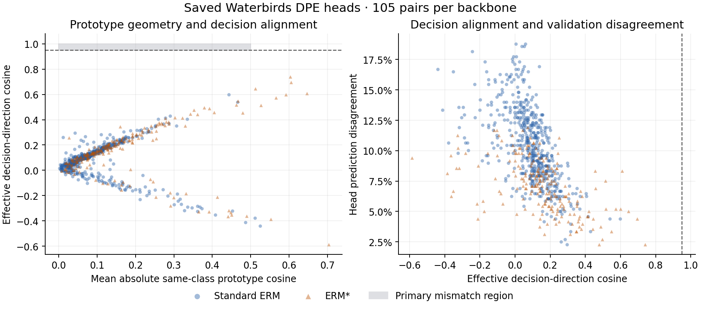

# Phase 2 Pilot 1 · Saved DPE head diversity

**Decision on 22 November 2026.** The proposed near-identical-boundary mechanism is a **no-go** for retraining. Across 735 pairs of saved DPE heads, the highest effective decision-direction cosine was **0.598 on standard ERM** and **0.741 on ERM\***. Zero pairs reached 0.90, the least restrictive cutoff in the pilot, and zero reached the primary cutoff of 0.95. The group-level criterion therefore had no qualifying pairs in any seed. Proceed to the frozen-readout controls in the representation-repair pilot.

**Research question.** Does the DPE diversity penalty allow trained heads with dissimilar prototypes to learn nearly identical decision boundaries and repeat the same group errors?

## Validation results

Each row describes all 105 pairs from a single 15-head ensemble. Median disagreement and extra correct predictions use the same 479 validation images for every backbone.

| Backbone | Seed | Median prototype cosine, absolute | Effective direction cosine, median / max | Median disagreement | Median extra correct, oracle | Median cancellation |
|---|---:|---:|---:|---:|---:|---:|
| Standard ERM | 0 | 0.075 | 0.089 / 0.403 | 11.06% | 19 | 61.4% |
| Standard ERM | 1 | 0.080 | 0.099 / 0.370 | 10.65% | 18 | 62.5% |
| Standard ERM | 2 | 0.091 | 0.109 / 0.598 | 9.19% | 18 | 49.1% |
| Standard ERM | 3 | 0.065 | 0.069 / 0.332 | 10.44% | 18 | 68.8% |
| Standard ERM | 4 | 0.077 | 0.105 / 0.429 | 9.81% | 14 | 51.5% |
| ERM\* | 0 | 0.094 | 0.121 / 0.414 | 7.72% | 13 | 63.2% |
| ERM\* | 1 | 0.185 | 0.208 / 0.741 | 6.26% | 11 | 67.6% |



The saved heads exhibit signed cancellation. The median stage lost 49.1%–68.8% of the termwise absolute sum across the seven backbones. Multiplying class-0 prototypes by 0.5 and class-1 prototypes by 2 changed the signed penalty at every stage after the first in all ensembles (98 of 98 stages), with zero change in replayed probabilities. The saved heads still had distinct decision directions and made complementary corrections. A typical pair could correct 11–19 additional images over its better head if an oracle chose the correct head per image. The group medians were 1–3 of 53 for group `10` and 0–1 of 53 for group `11`. Oracle counts measure available complementarity under perfect per-image routing.

The scope is seven saved binary Waterbirds ensembles under a single validation allocation. The comparison is descriptive and the pairs share heads and images. It does not identify the causal effect of the training penalty or settle whether another objective could help in a different setting.

## Forecast for Direction 1 · 23 November 2026

For the same Waterbirds setup, I expect replacing the signed prototype penalty with a termwise absolute penalty to have a small or seed-dependent effect on worst-group accuracy. The saved heads already have distinct decision directions and make some complementary corrections, so there is little evidence of the specific redundancy this change was meant to fix. This is a qualitative forecast. The pilot evaluated frozen heads and included no retraining comparison.

Keep Direction 1 on hold. I would revisit it if a second data setting repeatedly shows low prototype similarity alongside highly aligned decision directions and shared errors in the same group across seeds. A matched retraining test could then compare the signed penalty, termwise absolute penalty, and no penalty using identical sampling, head budgets, and aggregation. A repeatable improvement in held-out worst-group accuracy and complementary corrections would strengthen the case for pursuing this direction.

## Decision criteria

The [configuration](../../../configs/dpe_head_diversity/pilot.json) fixed the primary mismatch as mean absolute cosine between corresponding class prototypes at most 0.50 and effective direction cosine at least 0.95. Controls had effective direction cosine at most 0.80. A group needed at least three pairs of each type, a median of at least three errors shared by the affected pairs, and a median oracle gain at least two images greater in the controls. The same group had to qualify in at least three of the five standard ERM seeds. ERM\* was a separate check. Relaxed and strict sensitivity checks also returned no-go. The effective direction is the difference between the unit class-1 and class-0 prototypes, projected onto the zero-mean subspace imposed by the feature preprocessing.

## Reproduction and verification

Run from the repository root with NumPy, PyTorch, and Matplotlib (see the [run record](provenance.json) for exact versions).

```powershell
python -B -m scripts.analysis.dpe_head_diversity --config configs/dpe_head_diversity/pilot.json --output results/dpe/head_diversity_20261122
python -B -m unittest discover -s tests -p test_dpe_head_diversity.py -v
```

- The analysis used 479 official validation examples, disjoint from the 720-image pool used to train and select the individual heads. The 479 examples were used in prior aggregation studies. The raw dataset and official test split were untouched during this pilot.
- All 50,295 cached head decisions matched CPU replay and the independent analytic decision rule. The maximum absolute probability difference from the archived cache was `7.75e-7`.
- Six focused tests passed. An independent calculation reproduced the geometry and contingency counts for all 735 pairs and 3,675 pair-by-group rows. A rerun that blocked raw dataset and test-file access read exactly the 33 declared inputs and reproduced all three CSVs and the plot byte for byte.
- [Per-backbone summary](summary.csv), [per-head accuracy and penalty terms](heads.csv), [pair-by-group results](head_pairs.csv), and [input and output hashes](provenance.json).
