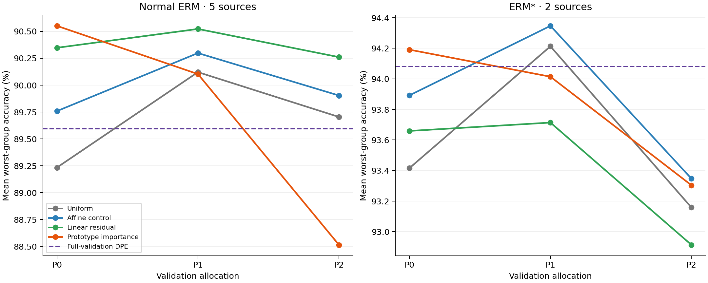

# Independent DPE methods: completed frozen-backbone study

Executed 2026-11-13. All **5,880 declared rows** completed: **5,222 distinct predictors and 658 algebraic aliases**, with no failed or missing configurations. Every row has its own test scores and canonical prediction export. No method or setting was selected for final testing.

The strongest primary-allocation prototype-weighting result does not survive every allocation. A fixed linear residual gives positive mean changes on all three normal-ERM allocations, but does not transfer that pattern to ERM*. Distinct H3 subsets and local evidence do not establish a broad improvement over original DPE.

## Protocol and evidence

Waterbirds official splits are 4,795/1,199/5,794; test groups 00/01/10/11 contain 2,255/2,255/642/642 examples. Normal ERM has five reused independent sources (seeds 0–4); ERM* has two (0–1). Sources, validation allocations, methods and folds are not pooled as independent repetitions. Means below average each source's minimum group accuracy.

Each source contributes 85 full-validation geometry rows, 240 rows at each of three 720/479 allocations, and 35 five-fold crossfit rows. Fitted methods use only their declared validation fitting labels. Test labels do not select settings, memberships, checkpoints or methods. Full-validation DPE is a separate complete-procedure reference.

The study ran in the managed Codex cloud execution workspace using four CPU worker processes. Earlier references to local execution mean that attached workspace. No backbone was trained. Saved features/heads were recovered from the two existing public Kaggle notebooks. New lightweight heads were fitted only for missing ERM* allocations and crossfit folds. The fresh Kaggle launcher was prepared and syntax-checked; no new Kaggle run was submitted.

Base source revision: `22b65ec5fc8f00b33938fe2af6dc32ad2f34ecfd`, plus the retained local implementation snapshot. New differentiable fits use the declared 400 CPU float64 Adam steps. Existing neural anchors preserve their AdamW recipes. All settings remain in the [configuration](../../../configs/dpe_independent/study.yaml).

See [execution, result counts and artifact availability](execution.md) for the 5,880-row/658-alias derivation, the CPU environment, public input sources, retained-output layout and reproduction commands.

## Baselines and fixed-procedure allocation sensitivity

WGA is in percent. P0/P1/P2 are nested validation allocations, not additional backbone sources. These are the **same fixed procedures** across allocations.

| Recipe / procedure | P0 | P1 | P2 |
| --- | ---: | ---: | ---: |
| Normal ERM (5 sources): Uniform | 89.2337 | 90.1213 | 89.7044 |
| Normal ERM (5 sources): Affine calibration, average loss, λ=.1 | 89.7588 | 90.2986 | 89.9038 |
| Normal ERM (5 sources): Linear residual, average loss, λ=.1 | 90.3478 | 90.5231 | 90.2611 |
| Normal ERM (5 sources): Prototype importance, shared scale, T=.05, maximum loss, λ=.01 | 90.5518 | 90.1033 | 88.5144 |
| Normal ERM (5 sources): Existing MLP, wd=.01 | 89.9578 | 89.9377 | 88.8785 |
| Normal ERM (5 sources): Existing dropout MLP, wd=.01 | 89.8537 | 90.4050 | 89.5639 |
| ERM* (2 sources): Uniform | 93.4161 | 94.2129 | 93.1586 |
| ERM* (2 sources): Affine calibration, average loss, λ=.1 | 93.8919 | 94.3468 | 93.3473 |
| ERM* (2 sources): Linear residual, average loss, λ=.1 | 93.6594 | 93.7140 | 92.9141 |
| ERM* (2 sources): Prototype importance, shared scale, T=.05, maximum loss, λ=.01 | 94.1910 | 94.0142 | 93.3041 |
| ERM* (2 sources): Existing MLP, wd=.01 | 93.7600 | 94.0133 | 92.3725 |
| ERM* (2 sources): Existing dropout MLP, wd=.01 | 93.8265 | 94.3681 | 92.8603 |

Full-validation original DPE means are **89.5950%** (normal ERM) and **94.0810%** (ERM*). These are our reproduced references, not paper-reported numbers.

### Prototype importance

The fixed shared-scale/T=.05/maximum-loss/λ=.01 procedure changes primary WGA by **+1.3181 pp** on normal ERM and **+0.7749 pp** on ERM*. It improves all five primary normal-ERM sources. On ERM* its paired changes are −0.6231 and +2.1729 pp: the mean gain does not mean both sources improve.

The same procedure's paired mean changes across P0/P1/P2 are:

| Recipe | P0 Δ (pp) | P1 Δ (pp) | P2 Δ (pp) |
| --- | ---: | ---: | ---: |
| normal_erm | +1.3181 | -0.0180 | -1.1900 |
| ermstar | +0.7749 | -0.1987 | +0.1455 |

The normal-ERM P2 reversal rejects an allocation-independent gain for this procedure. Calibration controls also remain competitive on the other allocations. Prototype importance is a useful exploratory signal, with substantial fitting sensitivity.

### Linear residual and matched calibration

The average-loss/λ=.1 linear residual has normal-ERM mean gains of +1.1141, +0.4018 and +0.5567 pp. Its gains over the corresponding affine-only control are:

| Recipe | P0 extra Δ (pp) | P1 extra Δ (pp) | P2 extra Δ (pp) |
| --- | ---: | ---: | ---: |
| normal_erm | +0.5890 | +0.2245 | +0.3572 |
| ermstar | -0.2325 | -0.6328 | -0.4332 |

For normal ERM the linear residual wins/loses/ties against uniform on 4/1/0, 4/0/1 and 4/0/1 sources across the three allocations. On ERM* it underperforms the matched affine control on all three allocation means. This is a recipe-specific finding, not a universal neural-aggregation advance.

## Every family remains in the results

The following are **ranges of source-mean WGA over fixed primary-allocation settings**. Extrema describe the completed grid; they are not selected predictors. Full per-source settings and controls remain in [per_seed.csv](per_seed.csv), and all 1,680 recipe/allocation/configuration summaries are in [summary.csv](summary.csv).

| Family | Normal ERM WGA range (%) | ERM* WGA range (%) |
| --- | ---: | ---: |
| Tempered original pairs | 89.1848–89.2337 | 93.3382–93.4382 |
| Distinct H3 subsets | 89.2294–89.4159 | 93.2381–93.4161 |
| Global prototype pooling | 89.2383–89.4514 | 93.3382–93.4161 |
| Local top-k evidence | 89.1630–89.6733 | 92.6827–93.3046 |
| Learned prototype importance | 88.0532–90.5518 | 91.0421–94.1910 |
| Prototype temperature/bias controls | 88.2395–89.9343 | 93.0685–93.8919 |
| Affine-only residual control | 89.4013–89.9059 | 93.3801–93.8919 |
| Linear residual | 89.3146–90.3478 | 92.9128–93.6594 |
| Nonlinear residual | 88.5499–89.9402 | 90.6874–92.8349 |
| Average/maximum-group Brier | 87.5122–89.1973 | 90.7539–93.1486 |
| Existing logistic/MLP/dropout anchors | 89.5580–89.9667 | 93.7378–94.0031 |
| Existing maximum-group NLL weights | 87.6009–89.2963 | 90.8869–93.5383 |
| Fitted H3+H2 combinations | 87.7339–89.9237 | 91.9956–94.0031 |

Distinct H3 subset gains are small and inconsistent across allocations. The best observed full-validation local-evidence mean is 89.8058% on normal ERM, versus 89.5950% original DPE; its best ERM* counterpart is 94.0031%, below the 94.0810% reference. Sharpening and original-pair controls are retained, so these changes are not automatically attributed to subset competition.

Certified maximum-group Brier fits do not improve the primary original-head uniform mean in either recipe. Some combinations improve particular allocations, without establishing a stable overall improvement. The tested nonlinear residual does not provide a consistent advantage over its simpler controls.

## Cross-fitting

Each procedure uses five 15-head ensembles. Calibration is fitted on out-of-fold predictions and applied to each fold ensemble before averaging test probabilities. The additional heads and different per-fold training pools change computation as well as data usage.

| Recipe | Uncalibrated original fold ensemble | Range of all 35 crossfit procedures | Full-validation original DPE |
| --- | ---: | ---: | ---: |
| normal_erm | 90.1393 | 88.0532–90.2736 | 89.5950 |
| ermstar | 93.6042 | 93.5599–94.0483 | 94.0810 |

The highest observed crossfit means are 90.2736% and 94.0483%. Normal ERM benefits from this fold ensemble; ERM* does not exceed its full-validation reference in mean. Uncalibrated fold controls prevent attributing the entire difference to calibration.

Each line shows one fixed procedure's source-mean WGA; no line switches settings between allocations. The plot is descriptive and does not show confidence intervals.

## Numerical recovery, verification and limits

The initial float32 CPU distance path differed from historical GPU probabilities by up to 7.75e-7, with unchanged decisions. That preflight and its outputs were retained. Float64 normalized distances reduce the maximum difference in all nine historical ensemble replays to 1.1921e-7, with zero changed head or uniform decisions. The 2e-7 historical tolerance was not relaxed.

Some initial Brier solves had a successful solver flag but failed the independent certificate. The final fitter retains quadratic shrinkage in its lower bound and refines rejected solves at tighter numerical tolerance. The objective and 1e-7 certificate acceptance threshold are unchanged; all final fits passed.

Final checks: **219 tests passed, 9 skipped**. The [independent audit](independent_audit.json) verified all 5,880 exports, 5,794 reference images per export, integer accuracy/group arithmetic, source summaries, frozen-state/head/snapshot hashes, Brier certificate evidence, and retained NumPy replay checks. Frozen-model replay tolerance is 1e-10 with no label differences. No independent CNN image replay was performed.

All results are exploratory. The same sources and test set informed earlier work, the grid is broad, and ERM* has only two sources. Positive source means, grid maxima or repeated allocations do not establish formal confirmation, population-level superiority, novel methods, or causal removal of background shortcuts. Historical ERM* feature markers lack a backbone digest and selected head epochs were not exported; those facts remain unavailable.

Full raw features, native heads, fitted parameters, canonical CSVs, per-predictor run/model records, source snapshots, solver histories, recovery evidence and logs remain outside Git. The source implementation, lightweight tables and audit evidence are included in this GitHub publication. Large generated artifacts remain outside Git.

Recreate the table/report from retained outputs with `scripts/analysis/summarize_dpe_independent.py`; rerun the read-only audit with `scripts/analysis/audit_dpe_independent.py`. The [method README](../../../src/methods/dpe_independent/README.md) and [fresh Kaggle notebook](../../../notebooks/dpe_independent_methods_kaggle.ipynb) document execution and recovery.
