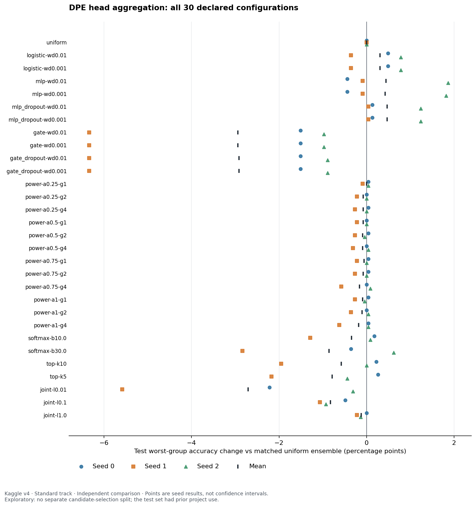

> Historical three-source evidence. The [completed five-seed report](five_seed_verification_20261112/README.md) is the current assessment; the dropout-specific advantage is not established.

# DPE head aggregation results from Kaggle version 4

Reviewed 2026-11-12 (Asia/Saigon). **Status: completed exploratory project adaptation.**

**Verification update:** the [user-run Kaggle verification](kaggle_verification_20261112/README.md) reproduced all three original seeds, all 90 results, fitted states and full test-image inference. The +0.4730 pp gain over matched uniform is confirmed for these runs; a dropout-specific advantage over plain MLP remains unsupported.

The [Kaggle run, version 4](https://www.kaggle.com/code/noerula/dpe-reweighting?scriptVersionId=367976457) completed all 30 declared configurations for seeds 0, 1 and 2. Uniform averaging reached **89.5196 ± 0.6538% test worst-group accuracy (WGA)**. None of the 19 nonuniform global weighting configurations improved mean WGA: one tied and 18 were lower. The dropout MLP had the highest observed mean WGA, **89.9926 ± 0.0923%**, a paired change of **+0.4730 ± 0.6672 percentage points**. Both weight-decay settings gave the same test decisions.

This is a modest exploratory neural-combiner result, not confirmation that assigning a single reliability weight to each head improves DPE. The ordinary gate collapsed to almost one head and lost **2.9416 WGA points** on average. Each configuration is evaluated independently, so the protocol does not require a separate candidate-selection split. The observed test gain is established by the saved predictions; its stability beyond three training seeds remains to be verified. The test set had already informed project research.

## Run identity and evidence

- **Kaggle notebook ID:** `143255000`; **script version ID:** `367976457`.
- **Executed source:** [notebook with saved outputs](https://www.kaggle.com/kernels/scriptcontent/367976457/download).
- **Run time:** 2026-11-10, 08:01:38–12:52:58 UTC, or 15:01:38–19:52:58 in Asia/Saigon; Papermill duration 17,479.78 seconds (4 h 51 min 20 s).
- **Implementation:** branch `experiment/dpe-neural-combiner`, clean commit [`8e14249f4b3510363be06f627182e2daa9926179`](https://github.com/chautanphat/waterbirds-shortcut-mitigation/tree/8e14249f4b3510363be06f627182e2daa9926179), aggregation runtime version 6.
- **Study ID:** `aggregation-standard-seeds012-0dcf563966c5`.
- **Environment:** Kaggle `NvidiaTeslaT4` machine shape; CUDA used for backbones/heads. Neural combiners ran on CPU in float64. Python 3.13.16, PyTorch 2.11.0+cu130, torchvision 0.26.0+cu130, CUDA 13.0, NumPy 2.1.3, SciPy 1.16.3. GPU count was not recorded in the inspected artifacts.
- **Completion evidence:** all four code cells completed without Papermill exceptions; summary status `complete`; completed/planned seeds both `[0, 1, 2]`; 30 model and test records per seed; final archive-download cell executed.

The [tracked experiment record](../../experiments/exp-dpe-waterbirds-reweighting-003/record.json) preserves actual settings, implementation hashes, source identities, evidence checksums and verification scope. The pending access review has been replaced by this completed analysis. Access was restored before retrieving these results.

## Protocol and actual settings

This run differs from the earlier reproduction notebook in the current checkout. Its executed code and manifests establish the protocol below; the older notebook's validation reuse and configuration defaults do not describe this run.

| Data role | Count | Use |
| --- | ---: | --- |
| Official training split | 4,795 | Backbone optimization |
| Official validation split | 1,199 | Fixed group-stratified split into the two roles below |
| Head training | 720 | Prototype fitting and head-epoch selection |
| Combiner training | 479 | Global reliability scores, joint weights and neural fits |
| Official test split | 5,794 | Evaluation of every frozen configuration |

The validation partition uses split seed 0 for all three training seeds. Head-training group counts are `[280, 280, 80, 80]`; combiner-training counts are `[187, 186, 53, 53]`, in group order `00, 01, 10, 11`. The two parts are disjoint and cover validation exactly. Test identities are disjoint from both and identical across seeds.

The backbone is ImageNet-1K V2 ResNet-50, trained for 100 epochs with SGD, learning rate 0.001, momentum 0.9, **weight decay 0**, class-balanced sampling, batch size 128 and two workers. It uses deterministic `Resize((256,256)) → CenterCrop(224)` and ImageNet normalization, with no photometric augmentation. The final epoch's checkpoint is used; the separately saved best-validation checkpoint is not the feature source. These details matter when comparing with older DPE runs or the paper.

Each seed trains 15 IsoMax+ heads on frozen 2,048-dimensional features. Raw features are standardized per row with population standard deviation, followed by L2 feature/prototype normalization. Head settings are 20 epochs, SGD learning rate 0.001, momentum 0.9, entropic scale 30, covariance coefficient 500,000 with the recorded scheduler, and prototype norm penalty 10. Each head draws a group-balanced subset of 320 examples from the 720 head-training examples. With batch size 256 and `drop_last=True`, each epoch makes one optimizer update and drops 64 subset examples for that epoch. Epoch selection evaluates all 720 head-training examples, with later epochs winning ties. It does not use combiner-training or test examples for head selection. Training and epoch selection still reuse the head-training split.

At inference, each head retains its own distance scale and uses temperature 1; the training entropic scale is not applied to inference probabilities. Uniform DPE averages probabilities, not logits.

### The 30 configurations

- Uniform averaging: one matched reference.
- Power rules: 12 combinations of `alpha ∈ {0.25, 0.5, 0.75, 1}` and `gamma ∈ {1, 2, 4}`. Weights interpolate between uniform and normalized powers of per-head **combiner-training** WGA.
- Softmax rules: reliability softmax with `beta ∈ {10, 30}`.
- Top-k rules: uniform averaging over the 10 or 5 heads with highest combiner-training WGA, with stable original-head-order ties.
- Joint weights: nonnegative weights summing to one, minimizing maximum group NLL plus `lambda * ||w − uniform||²`, with `lambda ∈ {1, 0.1, 0.01}`.
- Neural models: logistic stacker, 8-unit tanh MLP, MLP with head-prediction dropout, input-dependent convex gate, and gate with dropout. Each is run with weight decay 0.01 and 0.001, for ten configurations. All use full-batch group-balanced BCE, 400 fixed AdamW steps, learning rate 0.01 and seed `10000 + source_seed`; dropout probability is 0.25.

Logistic and MLP stackers transform the 15 waterbird probabilities into a new class probability; they are not constrained to a convex mixture of head probabilities. Gates produce sample-dependent simplex weights over the original probabilities. Parameter counts are 16, 137 and 263 for logistic, MLP and gate, respectively.

All configurations for all planned seeds are frozen before test evaluation. There is **no held-out candidate-selection split** and no selected winning family in the stored protocol. A training WGA printed by `candidate_comparison.csv` is an in-sample diagnostic, not an independent validation result.

## Results

All accuracy values below are percentages. Changes are percentage points relative to the same seed's uniform ensemble. “±” denotes **sample standard deviation over three training seeds**, not a confidence interval. WGA is the minimum of the four group accuracies; overall accuracy is sample-level accuracy over all 5,794 test images.

### Main comparisons

| Configuration | Test overall accuracy | Test WGA | Paired WGA change |
| --- | ---: | ---: | ---: |
| Uniform | 91.2668 ± 0.3293 | 89.5196 ± 0.6538 | 0 |
| Logistic, weight decay 0.01 | 91.4912 ± 0.0863 | 89.8251 ± 0.3664 | +0.3055 ± 0.5906 |
| MLP, weight decay 0.01 | 91.3186 ± 0.3524 | 89.9630 ± 0.6657 | +0.4435 ± 1.2417 |
| Dropout MLP, either weight decay | 91.4049 ± 0.1726 | 89.9926 ± 0.0923 | +0.4730 ± 0.6672 |
| Gate, either weight decay | 89.2475 ± 1.1812 | 86.5780 ± 2.5189 | −2.9416 ± 2.9564 |
| Dropout gate, either weight decay | 89.2533 ± 1.1823 | 86.6075 ± 2.5409 | −2.9120 ± 2.9861 |
| Joint weights, lambda 1 | 91.2898 ± 0.2790 | 89.4013 ± 0.6533 | −0.1183 ± 0.1116 |
| Joint weights, lambda 0.01 | 90.0529 ± 1.2513 | 86.8145 ± 2.1130 | −2.7051 ± 2.6722 |

[Exportable SVG](head_aggregation_kaggle_v4/wga_changes.svg). Every declared configuration is included; the markers show individual seeds and their mean.

### Dropout MLP compared with uniform by seed

Both MLP dropout weight decays give the same hard predictions in every seed. The table uses `mlp_dropout-wd0.01` once rather than treating the duplicate decisions as independent evidence.

| Seed | Uniform WGA | Dropout MLP WGA | WGA change | Overall change | Uniform errors corrected | New errors introduced |
| --- | ---: | ---: | ---: | ---: | ---: | ---: |
| 0 | 89.7561 | 89.8891 | +0.1330 | 0.0000 | 21 | 21 |
| 1 | 90.0222 | 90.0665 | +0.0443 | −0.0345 | 24 | 26 |
| 2 | 88.7805 | 90.0222 | +1.2417 | +0.4487 | 54 | 28 |

Most of the mean WGA gain comes from seed 2. On seeds 0 and 1, the worst group gains only three and one correct predictions, respectively. Positive WGA changes in all three seeds are encouraging but do not establish a reliable population-level improvement, particularly after examining 30 configurations.

### Per-group test accuracy

`00`: landbird on land; `01`: landbird on water; `10`: waterbird on land; `11`: waterbird on water. Test group counts are **2,255 / 2,255 / 642 / 642**.

| Seed | Configuration | 00 | 01 | 10 | 11 |
| --- | --- | ---: | ---: | ---: | ---: |
| 0 | uniform | 92.7273 | 89.7561 | 91.1215 | 91.2773 |
| 0 | mlp_dropout-wd0.01 | 92.4169 | 89.8891 | 91.4330 | 91.5888 |
| 1 | uniform | 93.5255 | 90.0222 | 90.3427 | 91.7445 |
| 1 | mlp_dropout-wd0.01 | 93.2594 | 90.0665 | 90.8100 | 91.7445 |
| 2 | uniform | 93.0820 | 88.7805 | 89.8754 | 92.2118 |
| 2 | mlp_dropout-wd0.01 | 92.5942 | 90.0222 | 90.9657 | 92.5234 |

Group `01` is the worst group for both these methods in all three seeds. The dropout MLP increases `01` and `10` accuracy while decreasing `00` accuracy in every seed; it redistributes errors rather than uniformly improving every group. All 360 configuration/seed/group rows, exact correct counts, NLL values and group changes are in [per_group.csv](head_aggregation_kaggle_v4/per_group.csv).

## Findings and interpretation

### Global reliability weighting did not help mean WGA

The mildest power rule (`alpha=0.25, gamma=1`) ties uniform mean WGA to rounding, while changing individual predictions. Its effective head count remains approximately 14.994–14.998 out of 15. Stronger softmax or top-k concentration is generally worse: softmax beta 30 loses 0.8574 mean WGA points and top-5 loses 0.7834. This does not support the simple H2 mechanism that ranking heads by combiner-training WGA and applying one global weight per head improves robustness under this protocol.

Joint fits also lose WGA as regularization weakens: −0.1183, −0.8278 and −2.7051 points for lambda 1, 0.1 and 0.01. Their objective is worst-group NLL, not worst-group classification accuracy. Lower fitted NLL and solver convergence therefore do not guarantee a WGA gain.

### Gates collapsed instead of preserving a useful ensemble

For the ordinary gate at weight decay 0.01, mean effective head counts on test are **1.0033 / 1.0024 / 1.0081**. The mean maximum weights are **99.8339% / 99.8806% / 99.5987%**, dominated by human-numbered heads **1 / 1 / 3**, respectively. Weight decay 0.001 gives the same hard decisions. Dropout gates remain concentrated, with effective counts only about 1.009–1.056.

The collapse accompanies a consistent WGA loss, particularly seed 1's −6.3415 points. In that seed, the ordinary gate corrects 46 uniform errors but introduces 261 new ones. It reduces landbird-on-water accuracy from 90.0222% to 83.6807%, while raising waterbird-group accuracies. This is observed concentration and an error tradeoff; it does not prove that the chosen heads use background shortcuts.

Group-balanced test NLL improves for the ordinary gate even while WGA falls: approximately **0.6513→0.6065**, **0.6496→0.6000**, and **0.6463→0.6069**. The result is consistent with a mismatch between probability-loss optimization and WGA. The current evidence does not isolate confidence differences, limited training data, or the optimization setup as the sole cause.

### Neural stackers show a small signal with a calibration confound

Logistic and MLP stackers can change probability scale and decision boundaries beyond a convex average. The dropout MLP reduces group-balanced test NLL to approximately **0.2427 / 0.2399 / 0.2418**, from uniform's approximately 0.65, but changes WGA by much less. Thus the observed gain cannot be attributed specifically to discovering which heads are reliable or to nonlinear complementarity. A simple calibration or threshold adjustment remains an untested explanation.

Training-only complementarity diagnostics show 34 / 30 / 31 uniform errors with at least one correct head, and 6 / 7 / 10 examples on which every head is wrong. The label-aware oracle WGA is 98.11 / 94.34 / 96.23%. These are combiner-training diagnostics, not deployable predictions or test performance. They show potential disagreement, not that a gate can learn to exploit it.

## Log and numerical audit

- All **300 backbone epoch records** are present: epochs 1–100 for each seed. Each final epoch reports training accuracy 100% on 4,736 sampled examples, while full-validation WGA is 60.1504 / 62.4060 / 59.3985%. Training count reflects 37 batches of 128 under class-balanced sampling with a dropped tail, not a missing official split. The train/validation gap is consistent with a shortcut-sensitive backbone, but does not by itself identify the learned features.
- All **45 heads** have completed records. Selected epochs range from 12 to 20; nine select epoch 20. Head losses are not printed epoch by epoch, so their detailed trajectories are unavailable from stdout. The final selection records and finite prediction caches are present.
- All **30 configurations per seed** have frozen records and test metrics. All neural fits record steps 0, 100, 200, 300 and 400 with finite training losses. No configuration is silently absent.
- Seed 0's `joint-l0.01` fit encountered SLSQP's “Positive directional derivative for linesearch.” It retried the **same objective** with `trust-constr`, which passed termination/feasibility checks and stored an objective-gap bound of approximately **1.36×10⁻⁹**, below the declared 10⁻⁷ tolerance. The same warning appears again during deterministic evaluation replay; it is not evidence of two different failed seeds. Other saved joint fits report successful SLSQP termination. Details are in [joint_solver.csv](head_aggregation_kaggle_v4/joint_solver.csv).
- The remaining warnings concern debugger frozen modules, future Python tar extraction defaults, and nbconvert escape sequences. The final notebook conversion completed. There are no error outputs or Papermill exceptions; inspected losses, model parameters and probabilities are finite.

Independent NumPy inference reproduced **all 90 test configurations and all 90 combiner-training metric records** from saved head probabilities and JSON model states. It also verified per-group NLL, exact paired fixed/new-error identifiers, summary means and sample standard deviations, prediction/metadata ID order and labels, split disjointness, available source-file hashes, and saved model/cache hashes. The exported summary exactly matches the notebook's printed summary.

This audit did not retrain models or regenerate probabilities from raw images. It verifies the saved prediction/model evidence, not a separate raw-image reproduction or a new unseen test set.

## Limits and follow-up

Keep this result separate from the earlier seed-0 DPE reproduction figures. The new run uses a reduced head-training pool, an independent combiner-training pool, a project Stage-0 profile with class-balanced sampling and zero weight decay, and newly trained backbones/heads. Its matched uniform reference is 89.5196% mean WGA; the historical 89.00% single-seed result is not the correct denominator for this comparison. This run is an exploratory adaptation, not verification of the paper's benchmark.

Three training seeds share one fixed validation partition and one test set. The low absolute WGA standard deviation of the dropout MLP is descriptive; its paired gain standard deviation is 0.6672 points. Each configuration has its own independently reported result; no extra selection split is needed for this comparison.

The next focused comparison should fit a scalar temperature and bias, or a threshold, to the uniform ensemble on combiner-training data and compare that prespecified control with logistic/MLP stackers. This would help distinguish calibration from learned head interactions. Further seeds and partition repetitions can assess stability. If gates are revisited, inspect concentration on training data and prespecify a uniform-mixture floor or entropy penalty before evaluation. These are follow-up proposals, not results from this run.

## Complete configuration table

No test-based winner is selected in this table. The full grid and its seed-wise evidence remain available even where mean performance is worse than uniform.

| Configuration | Overall accuracy (%) | WGA (%) | Paired WGA change (pp) |
| --- | ---: | ---: | ---: |
| gate-wd0.001 | 89.2475 ± 1.1812 | 86.5780 ± 2.5189 | -2.9416 ± 2.9564 |
| gate-wd0.01 | 89.2475 ± 1.1812 | 86.5780 ± 2.5189 | -2.9416 ± 2.9564 |
| gate_dropout-wd0.001 | 89.2533 ± 1.1823 | 86.6075 ± 2.5409 | -2.9120 ± 2.9861 |
| gate_dropout-wd0.01 | 89.2533 ± 1.1823 | 86.6075 ± 2.5409 | -2.9120 ± 2.9861 |
| joint-l0.01 | 90.0529 ± 1.2513 | 86.8145 ± 2.1130 | -2.7051 ± 2.6722 |
| joint-l0.1 | 91.1345 ± 0.1272 | 88.6918 ± 0.7460 | -0.8278 ± 0.3019 |
| joint-l1.0 | 91.2898 ± 0.2790 | 89.4013 ± 0.6533 | -0.1183 ± 0.1116 |
| logistic-wd0.001 | 91.4739 ± 0.0863 | 89.8251 ± 0.3664 | +0.3055 ± 0.5906 |
| logistic-wd0.01 | 91.4912 ± 0.0863 | 89.8251 ± 0.3664 | +0.3055 ± 0.5906 |
| mlp-wd0.001 | 91.2956 ± 0.3427 | 89.9483 ± 0.6431 | +0.4287 ± 1.2164 |
| mlp-wd0.01 | 91.3186 ± 0.3524 | 89.9630 ± 0.6657 | +0.4435 ± 1.2417 |
| mlp_dropout-wd0.001 | 91.4049 ± 0.1726 | 89.9926 ± 0.0923 | +0.4730 ± 0.6672 |
| mlp_dropout-wd0.01 | 91.4049 ± 0.1726 | 89.9926 ± 0.0923 | +0.4730 ± 0.6672 |
| power-a0.25-g1 | 91.2668 ± 0.2852 | 89.5196 ± 0.6053 | -0.0000 ± 0.0768 |
| power-a0.25-g2 | 91.2323 ± 0.2761 | 89.4457 ± 0.5765 | -0.0739 ± 0.1280 |
| power-a0.25-g4 | 91.2323 ± 0.2507 | 89.4457 ± 0.5765 | -0.0739 ± 0.1679 |
| power-a0.5-g1 | 91.2323 ± 0.2761 | 89.4457 ± 0.5765 | -0.0739 ± 0.1280 |
| power-a0.5-g2 | 91.2208 ± 0.2515 | 89.4309 ± 0.6021 | -0.0887 ± 0.1599 |
| power-a0.5-g4 | 91.2151 ± 0.1990 | 89.4309 ± 0.5253 | -0.0887 ± 0.1933 |
| power-a0.75-g1 | 91.2438 ± 0.2676 | 89.4605 ± 0.5889 | -0.0591 ± 0.1426 |
| power-a0.75-g2 | 91.1978 ± 0.2264 | 89.4457 ± 0.5765 | -0.0739 ± 0.1679 |
| power-a0.75-g4 | 91.1805 ± 0.1534 | 89.3570 ± 0.4501 | -0.1626 ± 0.3612 |
| power-a1-g1 | 91.2266 ± 0.2424 | 89.4309 ± 0.6021 | -0.0887 ± 0.1599 |
| power-a1-g2 | 91.2035 ± 0.2000 | 89.4161 ± 0.5140 | -0.1035 ± 0.2188 |
| power-a1-g4 | 91.1805 ± 0.1495 | 89.3422 ± 0.4905 | -0.1774 ± 0.3840 |
| softmax-b10.0 | 91.0252 ± 0.2416 | 89.1796 ± 0.6563 | -0.3400 ± 0.8205 |
| softmax-b30.0 | 90.7030 ± 0.4994 | 88.6622 ± 1.2802 | -0.8574 ± 1.7834 |
| top-k10 | 90.8411 ± 0.4285 | 88.9431 ± 0.9638 | -0.5765 ± 1.1957 |
| top-k5 | 90.7548 ± 0.5009 | 88.7361 ± 1.1401 | -0.7834 ± 1.2546 |
| uniform | 91.2668 ± 0.3293 | 89.5196 ± 0.6538 | +0.0000 ± 0.0000 |

## Saved research artifacts

CSV accuracy, WGA and confidence values are fractions in `[0,1]`; fields ending in `delta_pp` are percentage points. Counts are integer examples, and NLL uses natural logarithms.

| Artifact | Contents |
| --- | --- |
| [Experiment record](../../experiments/exp-dpe-waterbirds-reweighting-003/record.json) | Immutable run identity, actual settings, source hashes and audit scope |
| [Summary CSV](head_aggregation_kaggle_v4/summary.csv) | All 30 configurations, means and sample standard deviations |
| [Per-seed CSV](head_aggregation_kaggle_v4/per_seed.csv) | All 90 results, training metrics, paired error counts and concentration diagnostics |
| [Per-group CSV](head_aggregation_kaggle_v4/per_group.csv) | All 360 group rows with exact correct counts, accuracy changes and NLL |
| [Per-head CSV](head_aggregation_kaggle_v4/per_head.csv) | All 45 heads, selected epochs, combiner-training/test WGA and mean test confidence |
| [Neural training CSV](head_aggregation_kaggle_v4/neural_training.csv) | Fixed-step loss histories for all 30 neural fits |
| [Joint solver CSV](head_aggregation_kaggle_v4/joint_solver.csv) | All nine joint fits, termination state, retries and certificate where present |
| [Experiment log](../../docs/experiment_log.md#exp-dpe-waterbirds-reweighting-003--2026-11-10) | Project run index |

Raw executed notebook, extracted notebook outputs, full run log, downloaded model/prediction evidence, and the independent NumPy audit script are retained under `outputs/dpe-kaggle-v4/` and excluded from Git. Kaggle's study ZIP also retains the portable head/prediction source bundles. Large backbones and raw features were not downloaded for this review.
