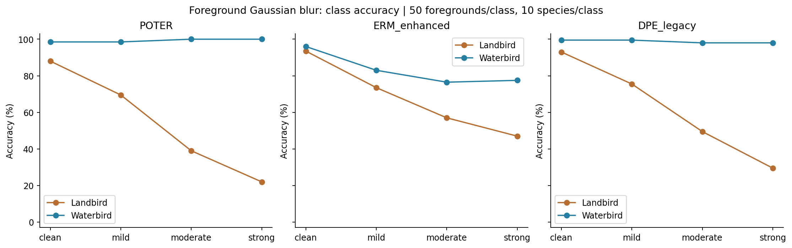
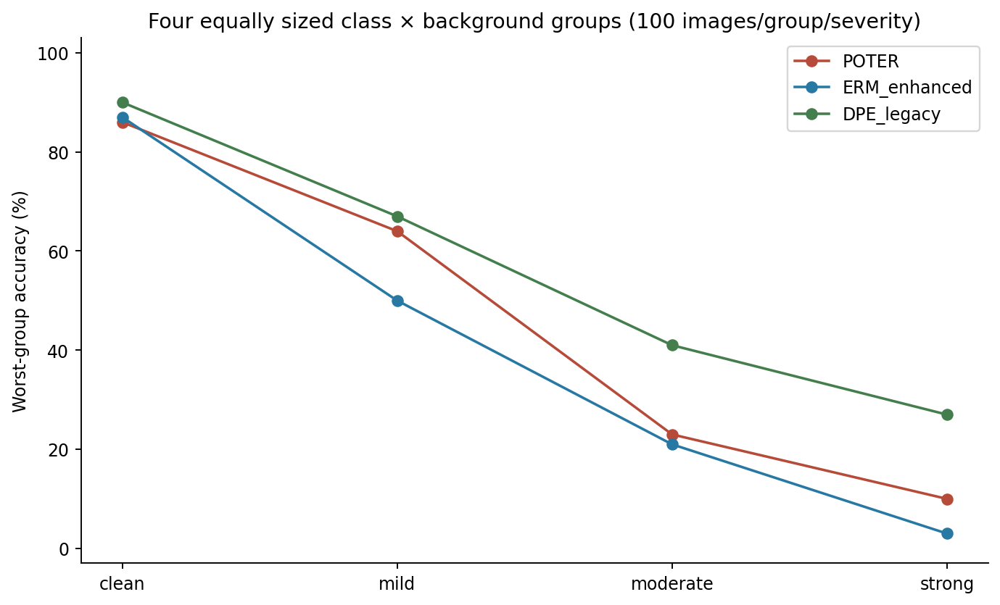
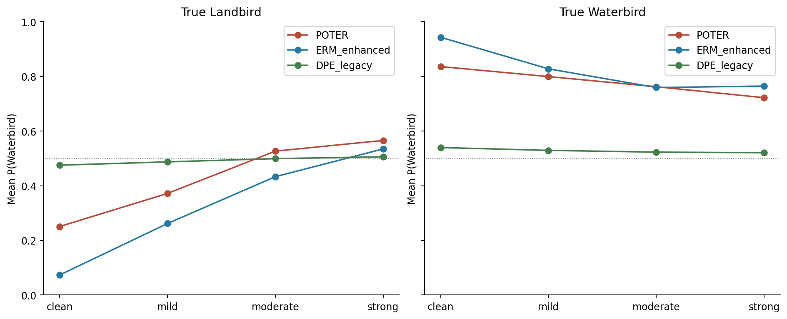
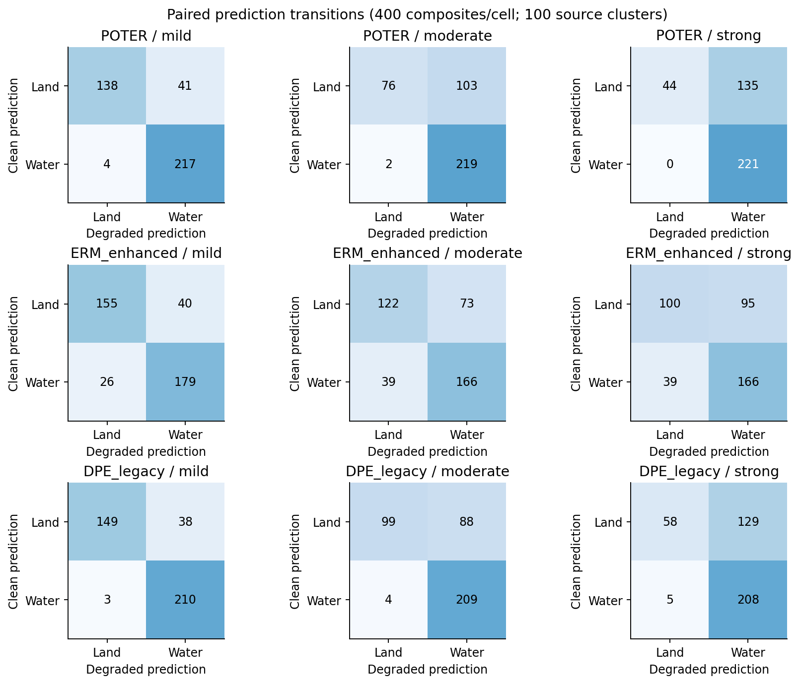
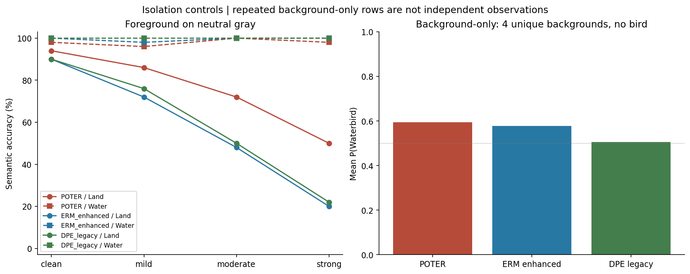
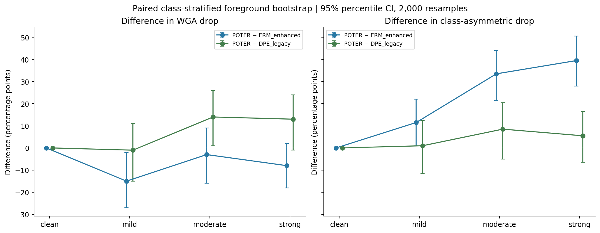
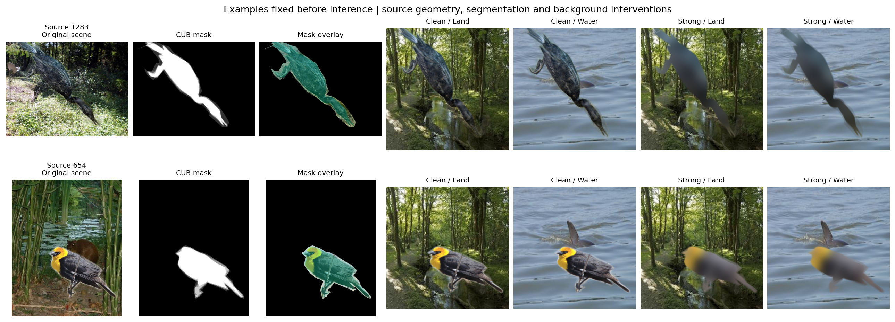
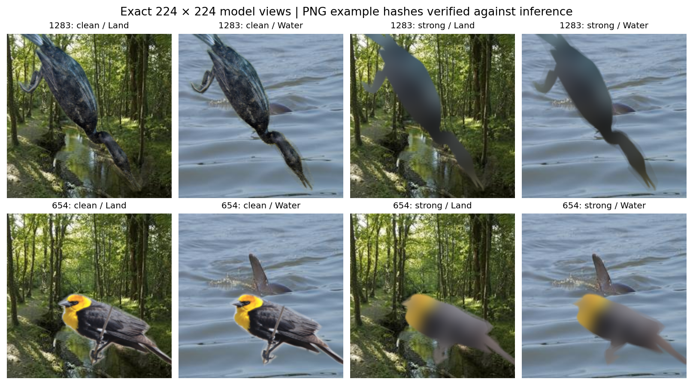

# Báo cáo so sánh POTER / ERM enhanced / DPE legacy

**Đã chạy inference thật với weight lưu sẵn, không train, không điều chỉnh checkpoint theo test.** Toàn bộ 5.794 ảnh test gốc × 3 model = 17.382 dự đoán; bộ replication 100 foreground × 25 ảnh × 3 = 7.500 dự đoán. 100 ảnh gốc của replication nằm trong full test; hai bảng lưu riêng và không được coi là mẫu độc lập bổ sung.

## Điều kiện so sánh và giới hạn checkpoint

- ERM checkpoint is enhanced/class-balanced ERM, not a standard uniform ERM baseline.
- POTER seed1 versus ERM/DPE seed0; one available image backbone per method, no matched three-seed comparison.
- Legacy DPE head/backbone historical hash binding is absent; exploratory pair association only.
- Same ResNet50 architecture, evaluation images, preprocessing and FP32 device settings; training recipes differ.
- DPE scores are log mean probabilities, not raw CNN logits; cross-model logit magnitudes are not comparable.

Không tìm thấy ba image-backbone seed khớp nhau cho mỗi phương pháp. Các head có seed khác trong project không tương đương ba backbone train độc lập. Không suy ra seed variance từ composite hay bootstrap. ERM enhanced có augmentation, class-balanced sampling, ImageNet V2, 400 epoch, LR 0.001, weight decay 0; POTER seed1 dùng checkpoint validation-selected epoch258 từ 300 epoch, LR 1e-5, weight decay1. Do khác recipe/seed và thiếu liên kết lịch sử DPE–backbone bằng hash, kết quả là so sánh exploratory các checkpoint hiện có, chưa xác lập khác biệt do thuật toán POTER.

## Audit và thiết kế

Xem `phase0_audit.md` và `phase0_audit.json`: recompute trực tiếp 400 dòng, kiểm tra mask/foreground invariance, nhãn, số ảnh, loài, nền, duplicate. File được gọi `predictions(1).csv` không được cung cấp; audit dùng đúng run 400 dòng được lưu trước đó và nêu rõ thay thế này.

Seed chọn mẫu 20261118, 50 foreground mỗi lớp, 10 loài mỗi lớp, 5 ảnh mỗi loài; chọn đều species rồi chọn ảnh, không dùng score/lỗi model. Loại 16 foreground sơ bộ và ba loài lỗi nhãn đã biết trước inference. `cohort.csv` và hash đã khóa trước lúc chạy. Đây là replication retrospective trên official test của checkpoint, không phải một tập test mới chưa từng được nghiên cứu.

Hai nền Land và hai nền Water cố định dùng chung cho mọi foreground/model/severity. Gaussian sigma0/1.5/4/9; foreground/mask/crop cố định, normalized masked convolution chỉ lên RGB của chim. Không tạo ảnh bằng AI. 1.600 natural composites + 400 neutral foreground-only + 400 background-only (chỉ 4 nền duy nhất lặp theo foreground) + 100 ảnh gốc. Mask không đổi giữa severity; cả ba nhận cùng tensor SHA-256. Giữ label canonical 0=Landbird, 1=Waterbird. Neutral có semantic accuracy nhưng không có four-group WGA; background-only không có target chim/accuracy/WGA.

## Toàn bộ test gốc — nhãn official

| model_name | n | semantic_accuracy | wga | landbird_accuracy | waterbird_accuracy |
|---|---|---|---|---|---|
| POTER | 5794 | 91.99 | 91.04 | 91.97 | 92.06 |
| ERM_enhanced | 5794 | 92.34 | 74.45 | 94.30 | 85.44 |
| DPE_legacy | 5794 | 96.05 | 94.39 | 96.41 | 94.78 |

Giá trị accuracy/WGA ở các bảng tính theo %. Full inference mới có5.330 ảnh POTER đúng; log Kaggle epoch258 ghi5.331. WGA và3/4 group accuracy khớp; nhóm Landbird/Land chênh1 ảnh. Chưa xác định nguyên nhân (runtime và nguồn JPEG/cache cũ khác); không sửa dự đoán để khớp log. Acceptance test so với POTER Runner hiện tại vẫn qua. Chi tiết trong `historical_poter_log_comparison.json`.

### Nhạy cảm với lỗi nhãn species

Ba species Eastern Towhee, Western Meadowlark, Western Wood-Pewee bị nhãn official Waterbird do match substring Tern trong Eastern/Western. Báo cáo official là chính; corrected đổi ba loài về Landbird và tính lại group, exclude bỏ ba loài. Không sửa dữ liệu gốc, không train hay chọn checkpoint lại.

| model_name | label_policy | n | semantic_accuracy | wga |
|---|---|---|---|---|
| POTER | official | 5794 | 91.99 | 91.04 |
| ERM_enhanced | official | 5794 | 92.34 | 74.45 |
| DPE_legacy | official | 5794 | 96.05 | 94.39 |
| POTER | corrected | 5794 | 92.89 | 90.88 |
| ERM_enhanced | corrected | 5794 | 92.51 | 77.80 |
| DPE_legacy | corrected | 5794 | 96.05 | 94.01 |
| POTER | exclude_known_errors | 5704 | 93.11 | 91.04 |
| ERM_enhanced | exclude_known_errors | 5704 | 93.09 | 77.80 |
| DPE_legacy | exclude_known_errors | 5704 | 96.77 | 94.77 |

## Replication đa loài — Gaussian

| model_name | severity | semantic_accuracy | wga | landbird_accuracy | waterbird_accuracy | predicted_waterbird_fraction | land_drop_pp | water_drop_pp |
|---|---|---|---|---|---|---|---|---|
| POTER | clean | 93.25 | 86.00 | 88.00 | 98.50 | 55.25 | 0.00 | 0.00 |
| POTER | mild | 84.00 | 64.00 | 69.50 | 98.50 | 64.50 | 18.50 | 0.00 |
| POTER | moderate | 69.50 | 23.00 | 39.00 | 100.00 | 80.50 | 49.00 | -1.50 |
| POTER | strong | 61.00 | 10.00 | 22.00 | 100.00 | 89.00 | 66.00 | -1.50 |
| ERM_enhanced | clean | 94.75 | 87.00 | 93.50 | 96.00 | 51.25 | 0.00 | 0.00 |
| ERM_enhanced | mild | 78.25 | 50.00 | 73.50 | 83.00 | 54.75 | 20.00 | 13.00 |
| ERM_enhanced | moderate | 66.75 | 21.00 | 57.00 | 76.50 | 59.75 | 36.50 | 19.50 |
| ERM_enhanced | strong | 62.25 | 3.00 | 47.00 | 77.50 | 65.25 | 46.50 | 18.50 |
| DPE_legacy | clean | 96.25 | 90.00 | 93.00 | 99.50 | 53.25 | 0.00 | 0.00 |
| DPE_legacy | mild | 87.50 | 67.00 | 75.50 | 99.50 | 62.00 | 17.50 | 0.00 |
| DPE_legacy | moderate | 73.75 | 41.00 | 49.50 | 98.00 | 74.25 | 43.50 | 1.50 |
| DPE_legacy | strong | 63.75 | 27.00 | 29.50 | 98.00 | 84.25 | 63.50 | 1.50 |

## Bất định và so sánh paired

Bootstrap percentile95%, 2.000 lần; resample 50 source foreground mỗi lớp có hoàn lại. Mọi background/severity/model của cùng foreground đi cùng nhau; WGA được tính lại trong mỗi resample. Bất định này có điều kiện trên bốn nền và các checkpoint cố định, không đo khả năng tổng quát sang nền khác hay seed train khác; tương quan species không được loại bỏ hoàn toàn bằng bootstrap ở mức ảnh. Class-asymmetric drop = drop Landbird − drop Waterbird. Số dương trong so sánh POTER−baseline nghĩa là POTER giảm mạnh hơn; CI cắt0 không cung cấp bằng chứng phân biệt rõ ở mẫu này.

| comparison | severity | metric | estimate | ci95_low | ci95_high |
|---|---|---|---|---|---|
| POTER_minus_ERM_enhanced | mild | wga_drop | -15.00 | -27.00 | -2.00 |
| POTER_minus_ERM_enhanced | mild | class_asymmetric_drop | 11.50 | 1.00 | 22.00 |
| POTER_minus_ERM_enhanced | moderate | wga_drop | -3.00 | -16.00 | 9.00 |
| POTER_minus_ERM_enhanced | moderate | class_asymmetric_drop | 33.50 | 21.50 | 44.00 |
| POTER_minus_ERM_enhanced | strong | wga_drop | -8.00 | -18.00 | 2.00 |
| POTER_minus_ERM_enhanced | strong | class_asymmetric_drop | 39.50 | 28.00 | 50.50 |
| POTER_minus_DPE_legacy | mild | wga_drop | -1.00 | -15.00 | 11.00 |
| POTER_minus_DPE_legacy | mild | class_asymmetric_drop | 1.00 | -11.50 | 12.50 |
| POTER_minus_DPE_legacy | moderate | wga_drop | 14.00 | 0.97 | 26.00 |
| POTER_minus_DPE_legacy | moderate | class_asymmetric_drop | 8.50 | -5.00 | 20.50 |
| POTER_minus_DPE_legacy | strong | wga_drop | 13.00 | -1.00 | 24.00 |
| POTER_minus_DPE_legacy | strong | class_asymmetric_drop | 5.50 | -6.50 | 16.50 |

## Kết luận từ dữ liệu

- **POTER:** Landbird 88.00% → 22.00%; Waterbird 98.50% → 100.00%; WGA 86.00% → 10.00%. Chênh lệch drop hai lớp 67.50 pp, CI95% [58.00; 76.00] pp.
- **ERM_enhanced:** Landbird 93.50% → 47.00%; Waterbird 96.00% → 77.50%; WGA 87.00% → 3.00%. Chênh lệch drop hai lớp 28.00 pp, CI95% [21.00; 35.00] pp.
- **DPE_legacy:** Landbird 93.00% → 29.50%; Waterbird 99.50% → 98.00%; WGA 90.00% → 27.00%. Chênh lệch drop hai lớp 62.00 pp, CI95% [54.50; 70.00] pp.
- POTER: accuracy Landbird giảm ở **10/10 loài Landbird** khi clean→strong (5 source foreground/loài).
- ERM_enhanced: accuracy Landbird giảm ở **10/10 loài Landbird** khi clean→strong (5 source foreground/loài).
- DPE_legacy: accuracy Landbird giảm ở **10/10 loài Landbird** khi clean→strong (5 source foreground/loài).

**Trả lời câu hỏi chính:** kiểu suy giảm bất đối xứng theo lớp tái hiện trên nhiều loài Landbird, nhưng cũng thấy rõ ở DPE. Với strong, chênh lệch class-asymmetric drop POTER−DPE là +5.50 pp, CI95% [-6.50; +16.50] pp. So với enhanced ERM, chênh lệch class-asymmetric drop là +39.50 pp, CI95% [+28.00; +50.50] pp; chênh lệch WGA drop là -8.00 pp, CI95% [-18.00; +2.00] pp. Khi CI chứa0, chưa đủ bằng chứng phân biệt độ suy giảm ở mẫu này. Không thể kết luận POTER yếu hơn cả hai baseline trên mọi tiêu chí, hoặc lỗi là riêng của POTER. Các phát biểu này chỉ áp dụng cho checkpoint/recipe hiện có.

Các bảng/CI cho biết collapse có tái hiện trong nhiều foreground và loài hay không; không quy kết POTER là nguyên nhân duy nhất. Original và clean recomposition là hai điều kiện khác nhau; xem `composition_artifacts.csv` và ảnh masks/composites trong `examples/` để đánh giá tác động ghép ảnh. Thay đổi từ clean sang blur giữ nguyên mask, nền và geometry, nhưng thí nghiệm không loại hết artifacts hay chứng minh cơ chế causal. Không có kiểm định đa so sánh; các CI là exploratory. Xác suất của các model chưa được calibration theo cùng thủ tục; nên ưu tiên các thay đổi paired trong model và accuracy/flip thay vì coi độ lớn confidence giữa model là tương đương.

### Kiểm tra hình ảnh và yếu tố gây nhiễu còn lại

Đã xem hai ví dụ định trước: mask giữ hình chim và hướng chim, nhưng biên có các dải mềm; ảnh654 có cấu trúc mảnh/occlusion qua chim; chim1283 nghiêng và chạm biên hình. Ảnh ghép đặt chim vào vị trí không nhất thiết tự nhiên. Nền Water được chọn có vật thể nhô khỏi mặt nước; các đối tượng/người/động vật trong nền chưa được sàng lọc. Vì vậy đây là đổi ảnh nền có ngữ cảnh, không phải một can thiệp chỉ thay thuộc tính trừu tượng Land/Water. Chỉ kiểm tra thủ công hai ảnh minh họa, chưa adjudicate mask của cả100 ảnh. `mask_quality_audit.csv` ghi diện tích mask trong đúng crop224 và lượng alpha còn lại sau crop cho100 foreground; sigma tuyệt đối giống nhau có thể tác động khác nhau theo kích thước chim. Không loại ảnh hay đổi severity sau khi xem dự đoán.

## Hình và dữ liệu

















`predictions.csv` giữ 7.500 dòng, `original_test_predictions.csv` giữ 17.382 dòng. Các row giữ source/species/background/label/model/model seed/severity/sigma/probabilities/scores, mask/input/tensor hashes. DPE dùng log(mean head probability), không được coi là logit CNN để so sánh độ lớn margin giữa model. `paired_flips.csv` có flip clean→degraded và đổi Land→Water background riêng, kèm chiều flip và delta P(Waterbird).

Lưu ảnh PNG cho hai foreground được định trước (mỗi lớp một ảnh), còn các ảnh khác lưu recipe/source/hash đủ tái tạo để tránh đầy ổ C. `group_metrics.csv`, `class_metrics.csv`, `bootstrap_ci.csv`, `metrics.csv`, `original_test_metrics.csv`, `original_test_label_sensitivity.csv`, `validation.json` và `checkpoint_audit.json` là dữ liệu máy đọc. `integrity.json` khóa file xuất cuối cùng.

## Thời gian thực đo

Full test gốc, ba model: **111.3 giây**. Replication100, ba model: **45.8 giây**. Không gồm thời gian tìm/audit checkpoint, smoke test và lập báo cáo. ERM/DPE dùng chung forward backbone; batch32 và ghi CSV trực tiếp nên nhanh hơn chạy ba lượt riêng và xuất mọi PNG trong UI.

## Chạy lại

```powershell
.\.venv\Scripts\python.exe scripts\investigate_poter_failure.py --config configs/poter_failure.yaml
.\.venv\Scripts\python.exe scripts\report_poter_failure.py --output results/poter_failure
```

Đổi `output_root` sang thư mục mới trong config trước khi chạy lại; chương trình không ghi đè run cũ. Chưa làm các experiment optional contrast/UrbanCars; ưu tiên audit và experiments1–5. Experiment5 chỉ hoàn thành CI foreground trên một checkpoint/method; xác nhận đa seed còn thiếu assets.

## Kiểm tra tự động

21 passed in 23.97s
